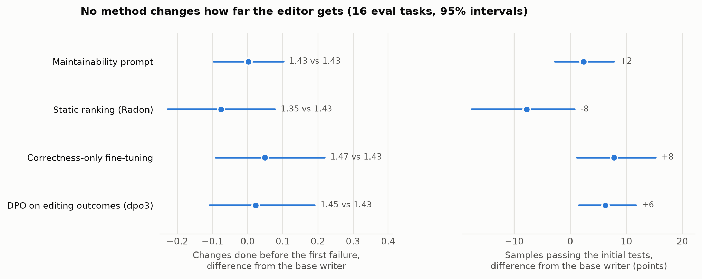
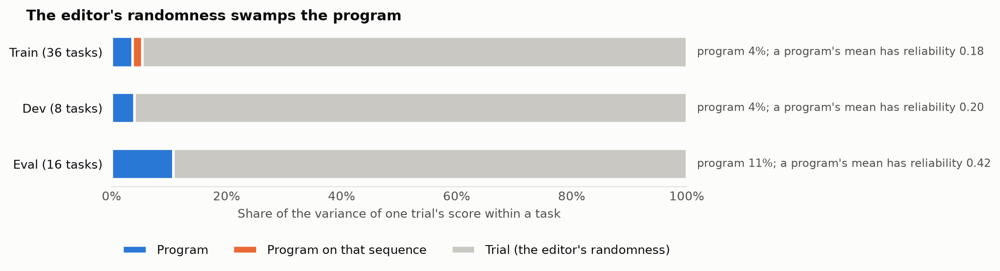
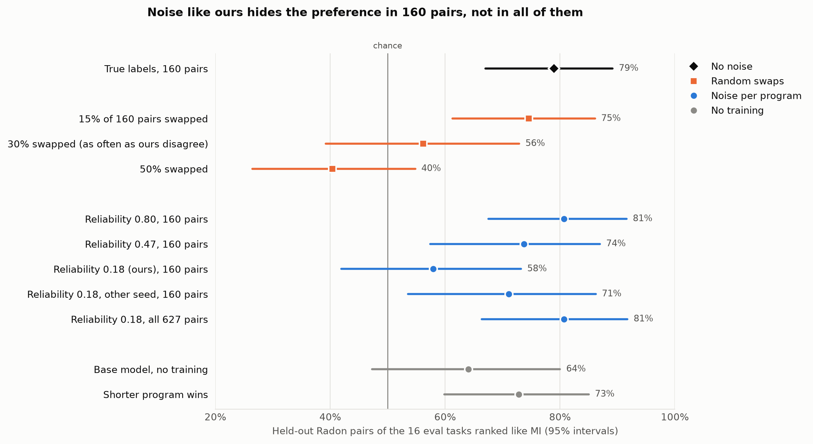
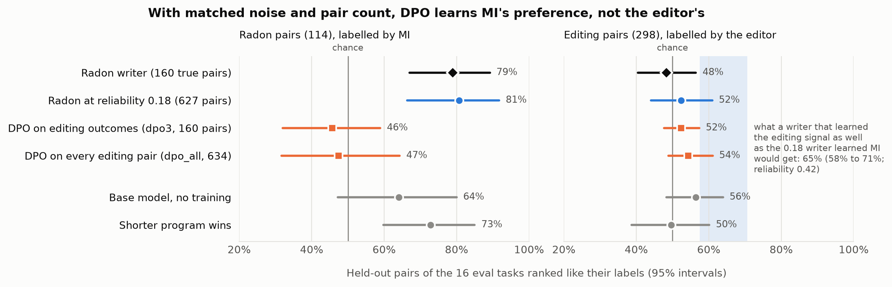

# Training a Code Writer on Later-Edit Outcomes: A Controlled Study

CMSC673 capstone, final report (draft of 2026-11-25). Results marked
*pending* are still running; the rest are final.

## Abstract

We asked whether a code-writing model trained on how well a fixed editing
model can later change its programs learns to write code that is easier
to change. We built 60 Python task families with initial specifications,
sequences of later change requests and hidden tests, sampled programs
from Qwen2.5-Coder-7B, had a frozen Qwen2.5-Coder-14B editor apply the
changes (2 sequences × 3 repetitions per program), turned the outcomes
into preference pairs and trained the writer with DPO (QLoRA, one 12 GB
GPU). On 16 held-out task families, neither our writer nor any of four
controls (the original writer, a maintainability prompt, DPO on Radon
maintainability rankings, fine-tuning on correct programs only) changes
how many changes the editor completes before its first failure: all
five lie within 0.12 of each other (1.35 to 1.47 of 3), and every
interval against the original writer includes 0. Two more training seeds
of our writer give +0.06 and +0.00 (over its three seeds, +0.03, −0.06 to
+0.14). Diagnostics explain
why: within a task, 95% of the variance of a trial's score is the
editor's randomness and 4% the program, so a program's mean over its six
trials has a reliability of 0.18. A label-noise control shows this noise
alone does not rule the method out: Radon scores degraded with
per-program noise of the same reliability still teach DPO the Radon
preference on held-out tasks when every pair is used (81% of held-out
pairs, as with clean labels). The same training on every pair of our
editing labels (634 pairs) carries nothing over (54% of held-out editing
pairs, where a writer that had learned their signal as well would reach
about 65%), and the editor gets no further on that writer's programs
(−0.00, −0.11 to +0.12). On this testbed the editing outcomes contain no preference
that is shared across tasks. We then built a second testbed of 30 task
families where the program's design decides whether undo can be added,
and sampled training programs that differ in design. There, the same
pipeline, with the chosen program's likelihood added to the DPO loss,
gives a writer whose held-out programs the editor changes further, with
all three training seeds. The gain is +0.24, +0.43 and +0.45 changes
before the first failure against the original writer (95% +0.10 to +0.39,
+0.20 to +0.66 and +0.23 to +0.69). Against fine-tuning on the same
programs without the editing outcomes, which itself gains nothing, it is
+0.22, +0.41 and +0.41. The cost is 11 to 22 points of initial
correctness, about half of it shared with that control. The original writer shown the worked example at eval time does at
least as well on programs that pass, but only by turning every program
into the copy design, and 81% of its samples fail their tests. Per sample,
it gains nothing, and averaged over its three seeds our writer scores
+0.16 above it (+0.01 to +0.34, computed after the results). Our writer's
gain comes mostly from in-place programs, which the example doesn't
produce. A second training round on the writer's own plain-prompt samples
(three seeds) gains +0.56 to +0.64 over the original writer and adds +0.20
(+0.01 to +0.43) to the first round. In tests fixed beforehand, it is
level with the prompted writer on programs that pass (−0.11, −0.35 to
+0.09). Per sample it is ahead (+0.18, +0.02 to +0.35), because twice as
many of its samples pass. Against a prompted control with twice the
samples, that lead is the same size but borderline (+0.17, +0.00 to
+0.34). We release the pipeline,
tasks, every preference pair, the diagnostics and the controls.

## 1. Introduction

Code that passes today's tests can still be hard to change tomorrow.
Agent-written code is measurably harder for later agents to build on
(CodeThread reports resolve-rate drops of up to 13.1 points; SlopCodeBench
finds structural erosion in 77% of trajectories), and static
maintainability metrics explain these differences only in part. A natural
response is to train the writer on the outcome that matters: how well a
later editor manages to change its code. CodeRhapsody proposes this but
reports no experiment. We implement it under controlled conditions.

Our research question: does training a code writer with preferences from
later-edit outcomes make it produce code that a fixed editor can change
more reliably, compared with training on initial correctness alone or on
a static quality score?

Contributions:

1. A rerunnable pipeline (task registry, sandboxed execution, a turn-based
   editor, a scorer with ties and consistency rules, DPO training and an
   evaluation that serves the trained writer exactly like the original),
   with component tests and CI.
2. 60 reviewed task families (36 train, 8 dev, 16 eval) with change
   sequences of nine kinds, two of which appear only in eval.
3. The controlled comparison of five writers on the 16 eval tasks, with
   paired task-bootstrap intervals and a comment ablation.
4. Diagnostics that measure, before any training, whether a testbed's
   editing outcomes can carry a learnable signal (variance components,
   held-out headroom, cross-sequence stability), and seven probes of
   editor, task and writer variants against them.
5. A label-noise control that separates "the labels are too noisy" from
   "the labels have no shared direction", using a known learnable signal
   (Radon MI) degraded to the editing labels' reliability.
6. A second testbed (30 families) where the program's design decides
   later changes. On it, a writer trained with DPO plus an NLL term on
   editing outcomes beats both the original writer and a matched
   correctness-only control on held-out tasks, with three training seeds,
   at a measured cost in initial correctness.

## 2. Related work

MaintainBench and MaintainCoder evaluate and improve generation under
changing requirements through an orchestrated workflow; CodeThread holds
the follow-on task fixed while varying who wrote the base code; SWE-CI
evaluates maintenance over continuous-integration cycles; SlopCodeBench
measures quality decay as agents extend their own code. These establish
that later-modification performance can be measured. ReaL trains for
quality with program-analysis feedback, and Sivapiran and Uddin compare
DPO and BoNBoN alignment for functional and non-functional quality, which
motivates our static-ranking and correctness-only controls. CodeRhapsody
proposes training on maintenance trajectories; our contribution is a
controlled implementation and evaluation of that idea, including what it
takes for such labels to be learnable. Our DPO+NLL loss (§7.2) follows
Pang et al. (2024, *Iterative Reasoning Preference Optimization*), who add
the chosen response's negative log-likelihood to DPO because plain DPO
can lower the likelihood of both responses. The other references are
those of the proposal (`docs/Project_Proposal_473_v2.docx.pdf`).

## 3. Setup

### 3.1 Tasks

Each task family has an initial specification with public and hidden
initial tests, and two sequences of later change requests, each change
with its own public checks and hidden tests for the new feature and for
earlier behaviour. Change kinds: validation rule, state flag, atomic
operation, undo, derived value, grouping, query, configuration and
concurrency control; the last two occur only in eval sequences. Train and
dev sequences have 2 changes, eval sequences 3. Every task passes
`validate-tasks`: the reference solution passes and planted bugs fail,
for the initial version and after each change. Task design, fixes and
the splits are documented in `harness/tasks/FAMILIES.md`.

### 3.2 Models and serving

- **Writer:** Qwen2.5-Coder-7B-Instruct, the official Q4_K_M GGUF, served
  by Ollama with an 8,192-token context; temperature 0.4 (chosen on dev),
  16 samples per task.
- **Editor:** Qwen2.5-Coder-14B-Instruct, Q4, same server, temperature
  0.7, never trained. A turn loop: per change it sees the whole current
  program, the request, summaries of its latest turns and the output of
  the public checks it last ran, and replies with complete new files and
  either RUN_CHECKS or DONE; at most 8 turns, 32,000 tokens and 600 s per
  change. It never sees hidden tests.
- **Hardware:** one RTX 5070 (12 GB) under WSL2; sandboxed execution in
  Docker (1 CPU, 512 MB, no network, 60 s).
- **Serving a trained writer:** the LoRA adapter is merged into the f16
  weights, converted to GGUF and quantized with the official file's
  per-tensor types. Applied to the untrained model, this route reproduces
  the official GGUF byte for byte, so differences between writers come
  from training, not conversion.

### 3.3 Scoring and preference pairs

A trial is one run of the editor through one change sequence on one
program, from a fresh copy. Its score is the number of consecutive
changes completed before the first failure; a change fails if a hidden
test of the new feature or of earlier behaviour fails or the editor runs
out of budget. Each passing, distinct program (at most 8 per task, in
sample order) gets 2 sequences × 3 repetitions; its score per sequence is
the mean over repetitions.

Two programs of a task form a pair under weak dominance (at least as good
on both sequences, better on one) when the winner is ahead by at least 2
changes in total; ties and inconsistent comparisons give no pair; at most
8 pairs per task, by margin. These settings were frozen on the dev tasks
before collecting training data.

The train collection drew 576 samples on 36 tasks: 177 failed the initial
tests, 46 were duplicates and 97 exceeded the 8-program cap, leaving 256
programs and 2,679 editing steps (72 GPU-hours of editing). They gave 821
comparisons and 229 pairs from 31 tasks (tie rate 0.19). Keeping pairs
whose winner wins in at least 2 of the 3 repetitions (182) and dropping
pairs whose programs differ only in strings, docstrings, local names and
annotations gives the training set: **160 pairs from 28 tasks**.

### 3.4 Training

Our own DPO loop (TRL's trainer exceeded 12 GB because it materializes
full-vocabulary logits): QLoRA with 4-bit NF4 weights, LoRA rank 16
(alpha 32, dropout 0.05) on every linear layer, beta 0.1, 2 epochs, 8
pairs per optimizer step, maximum length 3,200 tokens, seed 42; about 25
minutes and 8.3 GB per run. The learning rate was chosen on the dev tasks
between two runs (dpo2 and dpo3); dpo3 (2e-5) is our writer.

### 3.5 Methods compared

1. **Original writer.**
2. **Maintainability prompt:** the original writer, instructed to write
   clean, maintainable code.
3. **Ours (dpo3):** DPO on the 160 editing-outcome pairs.
4. **Static ranking (Radon):** DPO with dpo3's settings on 160 pairs of
   the same programs ranked by Radon Maintainability Index, matched per
   task to our pairs.
5. **Correctness-only (SFT):** supervised fine-tuning with dpo3's
   settings on the 201 passing programs our pairs were drawn from, without
   preferences.

All five are scored on the 16 eval tasks with the same editor, budget and
selection. Intervals resample the tasks with replacement, keeping each
task's pair of results together (paired task bootstrap, 20,000
resamples).

## 4. Results

### 4.1 Main comparison

| Method | Changes before first failure (of 3) | First change works | Whole sequence works | Samples passing initial tests |
|---|---:|---:|---:|---:|
| Original writer | 1.43 | 67% | 26% | 58% |
| Maintainability prompt | 1.43 | 70% | 25% | 60% |
| Ours (dpo3) | 1.45 | 71% | 25% | 64% |
| Static ranking (Radon) | 1.35 | 67% | 23% | 50% |
| Correctness-only | 1.47 | 72% | 25% | 66% |

Differences from the original writer (95% intervals):

| Method | Changes before first failure | First change works | Whole sequence works | Samples passing initial tests |
|---|---|---|---|---|
| Maintainability prompt | +0.00 (−0.10 to +0.10) | +3 pts (−1 to +8) | −1 pt (−5 to +4) | +2 pts (−3 to +8) |
| Ours (dpo3) | +0.02 (−0.11 to +0.19) | +4 pts (+0 to +9) | −1 pt (−6 to +5) | +6 pts (+2 to +12) |
| Static ranking | −0.08 (−0.23 to +0.08) | +0 pts (−6 to +8) | −3 pts (−8 to +1) | −8 pts (−18 to +1) |
| Correctness-only | +0.05 (−0.09 to +0.22) | +5 pts (+1 to +10) | −1 pt (−7 to +6) | +8 pts (+1 to +15) |

No method changes how far the editor gets. Our writer and the
correctness-only writer cannot be told apart on any measure (main measure
+0.03, −0.05 to +0.10, correctness-only minus ours), so the editing
outcomes in our pairs add nothing detectable to training on the same
programs. The one clear effect of training is on the first version: both
writers trained on the writer's own passing programs pass the initial
tests more often (+6 and +8 points); the Radon writer passes less often
(−8 points). Breaking earlier behaviour is rare for every writer (the
original writer's steps: 944 successes, 331 out of budget, 142 new-feature
failures, 12 earlier-behaviour failures, 5 both); most failures are the
editor running out of turns.

**Training seeds.** The proposal asks for three training seeds per
trained method. Our writer was trained twice more with the same pairs and
settings (seeds 2 and 3) and put through the same eval collection:

| Ours (dpo3), against the original writer | Changes before first failure | First change works | Whole sequence works | Samples passing initial tests |
|---|---|---|---|---|
| Seed 42 | +0.02 (−0.11 to +0.19) | +4 pts (+0 to +9) | −1 pt (−6 to +5) | +6 pts (+2 to +12) |
| Seed 2 | +0.06 (−0.03 to +0.14) | +6 pts (+2 to +11) | −0 pts (−4 to +3) | +4 pts (−0 to +10) |
| Seed 3 | +0.00 (−0.11 to +0.13) | +3 pts (−1 to +9) | −2 pts (−6 to +3) | +5 pts (−3 to +14) |
| Mean over the three seeds per task | +0.03 (−0.06 to +0.14) | | | |

No seed changes how far the editor gets. Every seed's first version
passes the initial tests a few points more often, and its first change
works a few points more often. race_telemetry, the task behind seed 42's
small gain, goes up with every seed (+1.03, +0.28 and +0.63); most other
tasks go both ways. The mean over seeds was computed after the results,
with the pooling used on the history suite (§7.5).

The correctness-only writer's second seed is no clearer: +0.10 (−0.04 to
+0.24) against the original writer and +0.07 (−0.03 to +0.19) against our
writer's seed 42, with first versions passing 7 points more often. Over
seeds per task (correctness-only seeds 42 and 2, ours 42, 2 and 3; after
the results), correctness-only minus ours is +0.05 (−0.02 to +0.12): the
two still cannot be told apart.

*Pending:* seed 3 of correctness-only and seeds 2 and 3 of Radon, running.

### 4.2 Comments

With every comment and docstring removed before the editor sees the code,
no writer's main measure moves by more than 0.02, and on the 52 programs
that had any, the editor does about as well without them (−0.04, −0.26 to
+0.19). Readability more broadly barely registers (§5.3): renaming
private names, data attributes and locals to meaningless ones and
removing comments and blank lines costs the editor 0.04 changes per
sequence (−0.17 to +0.07). No result depends on comments acting as hints.

## 5. Why nothing shows up on the original testbed

### 5.1 Diagnostics

| Check | Result | Reading |
|---|---|---|
| Held-out headroom: pick each task's best program by one sequence, score it on the other | train +0.03 (−0.04 to +0.10); eval +0.27 (+0.10 to +0.45) | a perfect selector of the writer's own programs gains almost nothing on train tasks |
| Do winners on sequence A win on sequence B? | 58% (47% to 68%) on train; two repetitions of the same sequence agree 60% | close to coin flips |
| Does dpo3's implicit reward rank held-out pairs? | 55% (47% to 63%) on dev and eval pairs; 97% on its training pairs | memorized, not learned |
| What separates winners from losers? | leave-one-task-out classifier 54% (43% to 64%); no feature replicates on eval; dpo3's code moved on no feature | nothing to learn |

Underneath all four: a two-way variance decomposition of one trial's
score within each task (programs and sequences random).

| Programs | Program | Program × sequence | Trial (editor randomness) |
|---|---:|---:|---:|
| Train | 4% (0% to 8%) | 2% | 95% |
| Dev | 4% (0% to 7%) | 0% | 96% |
| Eval | 11% (0% to 26%) | 0% | 89% |

A program's mean over its 6 trials therefore measures its own lasting
part with a reliability of 0.18 on train tasks (0.42 on eval tasks). More
trials help slowly: 2 sequences × 10 repetitions give 0.40, 8 sequences ×
3 repetitions 0.47. The writer's passing programs are small (median 47
lines) and share one design in 30 of 36 train tasks, and the editor
rewrites whole files.

We set a gate for any further training: a program share of at least 25%
and held-out headroom above 0.3 on dev tasks.

### 5.2 Probes of the testbed

Each probe changes one part of the testbed and reruns the diagnostics on
the dev tasks (details and reproduce commands in
`harness/results/diagnostics.md`):

| Probe | Result | Program share |
|---|---|---:|
| Editor at temperature 0.2 instead of 0.7 | same results; headroom −0.00 | 1% (0% to 16%) |
| Editor sends SEARCH/REPLACE patches | whole sequence 25% against 53% | 1% (0% to 16%) |
| Tasks built so that design matters (pilot) | reusing and repeating designs fare alike | 0% |
| 7B editor | first change 40% against 72%, failures not tied to programs; headroom +0.03 | 7% (0% to 19%) |
| 3B editor | almost never finishes a change | – |
| Writer samples drawn with 8 design hints | no hint's programs beat their task's average | 2% (0% to 7%) |
| Editor sees an outline and opens code on demand | 0.94 changes per sequence against 1.23 | 0% (0% to 4%) |
| 3B writer | 8% of dev programs pass the initial tests | – |

Hand-written programs show what is missing (design probe): the editor
writes a change its own way whatever the program already offers. Asked to
build on the program's design, it does: a program that logs its
operations then passes undo in 4 of 6 trials, against 0 of 6 for the same
program keeping plain state. But the writer's own programs do not differ
in such ways, and design hints do not make them. Taken one change at a
time, 9 of the 72 first changes on the train tasks have a program share of
25% or more (stock_portfolio's undo: 4 programs always pass, 4 always
fail), but 43 have none, and a task's other change rarely favours the same
programs. A pair's label reflects how one change's edge case met one
program.

### 5.3 Readability

With every dev program obscured (no comments, docstrings or blank lines;
private names, data attributes and locals renamed), the 14B editor gets
1.21 changes per sequence instead of 1.25 (−0.04, −0.17 to +0.07), and its
first change works as often. The 7B editor does not notice either (+0.03,
−0.06 to +0.12). The writers' programs differ in readability far less than
that, so no change in names, comments or layout can show up in this
score.

## 6. Is it the noise, or the signal?

Section 5 shows the labels are noisy. It does not show whether noise
alone defeats the method: a learnable signal under the same noise might
still come through. We test this with a signal we know DPO can learn.

### 6.1 A learnable signal: Radon MI

The Radon writer learns its formula's preference and carries it over: on
114 Radon-ranked pairs of the base writer's eval-task programs, its
implicit reward (log-probability under the adapter minus under the base
model) prefers the higher-MI program 79% of the time (67% to 89%), and its
own eval-task programs score +0.43 base standard deviations higher on MI
(+0.04 to +0.88).

### 6.2 Degrading it

We retrain the Radon writer with dpo3's settings on degraded labels and
score the same held-out pairs:

- **Random swaps** of 15%, 30% and 50% of its 160 pairs. 30% makes two
  labels agree as often as the editing labels agree across sequences
  (0.7² + 0.3² = 0.58).
- **Per-program noise**, which is what the editing labels have: each
  program is ranked by its MI standardized within the task times √R plus
  Gaussian noise times √(1 − R), drawn once per program, so R is the
  reliability. R = 0.18 matches the editing scores. With 160 pairs matched
  per task to dpo3's (two seeds at 0.18), and with every unequal pair at
  0.18 (627 pairs).

Random swaps behave as expected: 75% at 15%, 56% (39% to 73%) at 30%, 40%
at 50%; with 30% swapped the writer's programs no longer move up MI
(+0.06, −0.08 to +0.20). But random swaps contradict each other, so DPO
cannot fit them (final loss 0.67). Per-program noise never contradicts
itself, and that changes the picture. At R = 0.18, 160 pairs are a coin
toss (58% and 71% for two seeds); at 0.47, 74%; at 0.80, 81%. With every
pair at 0.18 the writer carries the preference over as well as with clean
labels, 81% (66% to 92%), although 31% of its pairs prefer the lower-MI
program. Spread over every pair of every program, what the noisy pairs
have in common is the signal. So our labels' noise explains why 160 pairs
could not be relied on; it does not by itself rule the method out.

### 6.3 The editing labels with every pair

We then train the matching writer on the editing labels: one mean
editing score per program and every pair whose scores differ (scorer
rule `aggregate`, no cap), 634 pairs from 36 train tasks, dpo3's settings
(dpo_all). It fits them tightly (final loss 0.33, against 0.59 for the
0.18 Radon writer). On the base writer's held-out editing pairs, paired
the same way:

| Ranker | Eval-task editing pairs (298, 16 tasks) | Dev-task editing pairs (98, 7 tasks) |
|---|---:|---:|
| Chosen program is shorter | 50% (39% to 60%) | 53% (39% to 67%) |
| Base model log-probability | 56% (48% to 64%) | 57% (46% to 68%) |
| dpo3 (160 pairs) | 52% (48% to 57%) | 37% (28% to 47%) |
| **dpo_all (634 pairs)** | **54% (49% to 61%)** | **47% (29% to 66%)** |

Held-out editing labels are noisy too, so even a writer that had learned
their signal could not rank them all correctly. How far it could get
follows from the control: over every pair of the Radon eval programs, the
0.18 Radon writer ranks 71% like MI, and against MI degraded to the eval
editing scores' reliability (0.42) it ranks 65% (58% to 71% over 400
draws of the noise). dpo_all ranks 54%, no better than the base model's
own log-probability.

With matched noise and pair count, DPO learns MI's preference and not the
editing labels'. What the editing scores share within a task does not
point the same way across tasks.

The main measure agrees. In the full eval collection with the editor,
dpo_all completes −0.00 changes before the first failure against the
original writer (−0.11 to +0.12) and −0.03 against dpo3 (−0.19 to +0.09).
That is over 14 tasks: on rover_fleet and task_board none of its samples
pass the initial tests. Fewer of its samples pass than the original
writer's (−13 points, −26 to +0) or dpo3's (−20, −32 to −8). Four times
the pairs train the writer harder on these labels and cost correctness,
but leave the editor's results unchanged.

The 627-pair Radon writer's own eval-task code moves up MI like the clean
writer's: +0.58 of the original writer's standard deviations (+0.16 to
+1.11), against +0.43 (+0.04 to +0.88). Its correctness collapses, though:
on 7 of the 16 eval tasks none of its samples pass the initial tests. By
contrast, dpo_all's code mainly gains docstrings (+3.65 standard
deviations), which have nothing to do with editing scores (within-task
correlation −0.16).

## 7. A testbed where the program decides

Sections 5 and 6 put the problem in the testbed, not in the training
method. So we built a second testbed around the one setting where design
decided the outcome (the design probe of §5.2). We ran the method on it
with the same writer and editor.

### 7.1 The history suite

There are 30 new task families: 16 train, 4 dev and 10 eval
(`harness/tasks/HISTORY_SUITE.md`). Each specification has composite
operations (move everything from one place to another, close one place
into another, merge) and getters that return things in the order they were
added. It never says how to store the state. Every sequence contains an
undo change: undo reverses the most recent successful call that changes
the state, a composite call as a whole, and restores order and removed
things exactly. Sequence s1 starts with undo. Sequence s2 starts with
another change and has undo second. Eval sequences have 3 changes,
including one of the eval-only kinds. The editor uses the prompt that asks
it to build on the program's design, with 5 turns per change (only 2.3% of
the successful steps in our store had needed more) and one trial per
sequence. These settings were fixed before any eval trial.

Two obstacles came up on the first three train tasks:

- **Undo failed for every program alike:** 1 of 92 trials succeeded, and
  the program's share of the score was 0%. The editor writes undo as
  inverse calls to the program's own methods, which record themselves
  again, and once stuck it resends its file until its turns run out. A
  hand-written probe on one task separated the designs. Undo as the first
  change worked in 2 of 3 trials for a program that makes each change on a
  deep copy of its state and keeps the copy only if the call succeeds, and
  in 0 of 3 for the same program changing its state in place.
- **The writer never wrote that design.** It ignored it when described in
  prose (2 of 35 passing programs) and when given as a code fragment (1 of
  24). A complete small example class for an unrelated specification, which
  names no task, change or undo, was followed by every sample shown it.

The train collection shows that example to three quarters of the 16
samples per task. The pairs keep the plain prompt, so the trained writer
has to adopt the design without seeing the example. On the 16 train
tasks, the programs with the copy design score 0.76 changes per sequence
and the others 0.40. Measured against their task's mean, that is +0.16
(95% interval +0.08 to +0.26) against −0.13 (−0.22 to −0.05). On the
original testbed no hint did this (§5.2). Scoring every unequal pair of
mean scores gives 83 pairs, and 74 of them prefer a copy-design program.

### 7.2 Training

Plain DPO with dpo3's settings didn't change the writer: 0 of its 21
passing dev programs used the copy design, as for the original writer (0
of 30). A copy-design program is very unlikely under the plain prompt, and
DPO can widen its margin by making both programs less likely. So we add
the chosen program's per-token negative log-likelihood to the loss, with
weight 1. This is DPO+NLL, as in RPO (Pang et al., 2024), and the same
loss as our correctness-only control. The learning rate and epochs were
chosen on the dev tasks only (writer samples, no editing), by rules
written down before each round of training:

| Setting | lr, epochs | Passing dev programs | Copy design among them |
|---|---|---:|---:|
| Original writer | – | 30 | 0 |
| Plain DPO | 2e-5, 2 | 21 | 0 |
| A | 2e-5, 2 | 27 | 0 |
| **D (ours)** | **3e-5, 3** | **20** | **10** |
| C | 5e-5, 2 | 18 | 11 |
| B | 5e-5, 3 | 7 | 4 |

B learned the design but overfit and lost correctness. The eval only
scores tasks where both writers have a passing program, so B would have
dropped tasks. Its eval was stopped during writer sampling, before any
editing. C and D were then added under a revised rule: a setting needs at
least two thirds of the original writer's passing programs, and then the
most passing copy-design programs wins. That rule picked D.

The control is SFT on the same train collection's passing programs: 83
programs, both designs, plain prompt, with D's lr and epochs and no
editing outcomes. It has the same programs and the same amount of
training, and lacks only the editor's preferences. On the dev tasks, 1 of
its 29 passing programs used the copy design.

### 7.3 Results

Our writer was trained three times with setting D, with seeds 42, 43 and
44 (same pairs, settings and code; the seed changes the LoRA
initialisation and the order of the pairs). The tables use 9 eval tasks:
recipe_binder has no edited program for the original writer or the
control. Seed 44 also has no passing sample on spare_parts, so its
comparisons use 8 tasks. Seed 44's comparisons were fixed before it was
trained. Intervals come from the paired task bootstrap as before
(`harness/results/hist2_eval.md`).

| Writer | Changes before first failure (of 3) | First change works | Whole sequence works | Samples passing initial tests |
|---|---:|---:|---:|---:|
| Original writer | 0.31 | 31% | 0% | 64% |
| Correctness-only (SFT) | 0.33 | 30% | 0% | 53% |
| **Ours (DPO+NLL, D), seed 42** | **0.55** | **41%** | **6%** | **42%** |
| **Ours, seed 43** | **0.73** | **46%** | **11%** | **53%** |
| **Ours, seed 44** (8 tasks) | **0.73** | **46%** | **10%** | **46%** |

| Difference (95% interval) | Changes before first failure | First change works | Whole sequence works | Samples passing initial tests |
|---|---|---|---|---|
| Correctness-only − original | +0.02 (−0.03 to +0.06) | −1 pt (−6 to +4) | +0 pts | −11 pts (−21 to −1) |
| Ours (seed 42) − original | +0.24 (+0.10 to +0.39) | +10 pts (+5 to +15) | +6 pts (+0 to +11) | −22 pts (−38 to −5) |
| Ours (seed 43) − original | +0.43 (+0.20 to +0.66) | +15 pts (+7 to +24) | +11 pts (+3 to +20) | −11 pts (−28 to +7) |
| Ours (seed 44) − original | +0.45 (+0.23 to +0.69) | +17 pts (+11 to +24) | +10 pts (+2 to +20) | −9 pts (−22 to +5) |
| Ours (seed 42) − correctness-only | +0.22 (+0.07 to +0.40) | +10 pts (+2 to +19) | +6 pts (+0 to +11) | −11 pts (−24 to +1) |
| Ours (seed 43) − correctness-only | +0.41 (+0.18 to +0.66) | +16 pts (+7 to +26) | +11 pts (+3 to +20) | +0 pts (−13 to +12) |
| Ours (seed 44) − correctness-only | +0.41 (+0.19 to +0.66) | +16 pts (+10 to +21) | +10 pts (+2 to +20) | +2 pts (−5 to +9) |

Seed 44's pass-rate differences are on its 8 tasks; on the 9, 46% of its
samples pass against the original writer's 64%. Seed 43 and the original
writer both have an edited program on recipe_binder too. With it, their
planned 10-task comparison gives +0.53 (+0.26 to +0.83), but that task
rests on one passing sample per writer.

The editor completes more changes on our writer's programs than on the
original writer's, with all three training seeds. Training on the same
programs without the editing outcomes gains nothing, so the gain comes
from the editing outcomes. Its size depends on the training seed. Seed 43
gains nearly twice as much as seed 42 on the same tasks (difference +0.18,
+0.04 to +0.32), and seed 44 about as much as seed 43 (+0.07, −0.10 to
+0.26). The task bootstrap does not include training-seed variation, and
three seeds measure it only roughly.

The gain has a cost in correctness:

- **Seed 42:** 22 points fewer of its samples pass the initial tests, half
  of that shared with the control.
- **Seed 43:** 11 points fewer, the same as the control.
- **Seed 44:** 18 points fewer on the 9 tasks. It has no passing sample on
  spare_parts, where the original writer passes 14 of 16; on its 8 tasks it
  passes as often as the control.

If a sample that fails the initial tests counts as 0 changes (a measure
computed after the results for seeds 42 and 43, all 10 tasks), the
original writer scores 0.17 changes per sample, the control 0.16, seed 42
0.23, seed 43 0.37 and seed 44 0.31. Against the original writer that is
+0.05 for seed 42 (−0.04 to +0.15), +0.19 for seed 43 (+0.05 to +0.36) and
+0.14 for seed 44 (−0.05 to +0.34). So the gain is clear for programs that
pass their tests, which are the ones an editor would be given. Per sample,
it is positive with every seed but clear with one.

The editor gets unstuck more often:

- **Run out of turns:** 47% of steps on the original writer's programs; on
  ours, 28% with seed 42 and 27% with seed 43.
- **Succeed:** 23% on the original writer's programs; on ours, 38% and 46%.
- **Undo first:** no original-writer program gets its first change done (0
  of 69). On ours, 7 of 51 do with seed 42 and 14 of 64 with seed 43.

The gain is not the copy design we trained toward, as far as our
classifier can tell:

- On eval, our writer's programs classified as copy designs score lower
  than its other programs: 0.38 against 0.79 with seed 42, 0.52 against
  0.97 with seed 43 and 0.69 against 0.81 with seed 44.
- The undo-first successes are mostly in-place programs: all 7 with seed
  42, and 11 of 14 with seed 43.

The classifier counts any deep copy in a mutating method, so it is crude.
The property that makes our writer's programs easier to edit is not
captured by it, nor by length, number of methods or number of classes.

**Against the prompt it was trained from.** Our writer's training samples
were drawn with the worked example in the prompt. So the original writer,
given the same example on every eval sample, is a control that needs no
training: if it does as well, training adds nothing beyond the prompt.
Four eval tasks changed after the runs above (a later commit added Usage
sections to files the models never see, but which the task hash covers),
so the prompted writer was run on those 4 with their earlier files, like
the other writers. The comparison uses all 10 tasks (9 for seed 42 and the
correctness-only control, which have no edited program on one; 8 for seed
44). The prompted control was run after seeds 42 and 43 and before seed
44, so seed 44's comparisons with it were fixed before seed 44 was
trained, including the two that were computed after the results for the
other seeds.

| Difference (95% interval) | Changes before first failure | First change works | Samples passing initial tests |
|---|---|---|---|
| Prompted − original | +0.56 (+0.37 to +0.75) | +28 pts (+15 to +38) | −39 pts (−54 to −23) |
| Ours (seed 42) − prompted | −0.33 (−0.62 to −0.00) | −15 pts (−28 to −1) | +21 pts (−1 to +40) |
| Ours (seed 43) − prompted | −0.03 (−0.38 to +0.35) | −4 pts (−21 to +15) | +29 pts (+9 to +44) |
| Ours (seed 44) − prompted | −0.19 (−0.41 to −0.01) | −12 pts (−23 to +1) | +37 pts (+23 to +51) |
| Correctness-only − prompted | −0.55 (−0.76 to −0.36) | −26 pts (−35 to −16) | +32 pts (+19 to +45) |

- **On programs that pass, the prompt does at least as well as training.**
  Seed 43 matches the prompted writer; seeds 42 and 44 fall below it.
- **The prompt gets there only through the copy design.** All 31 passing
  programs of the prompted writer are copy designs, against about half of
  ours. 81% of its samples fail the initial tests (42% for the original
  writer).
- **A generic prompt does not.** The original writer told only to write
  maintainable, easy-to-change code completes 0.31 changes on the same 9
  tasks, the original writer's level. That run was on a different machine
  (a cluster GPU with an Apptainer sandbox), so it is not matched and has
  no interval (`harness/results/hist2_maintain_nexus.md`).
- **Per sample, the prompt gains nothing, and our writer's gain over it is
  not established.** Counting failing samples as 0, the original writer
  scores 0.17 changes per sample, the prompted writer 0.14, and ours 0.23,
  0.37 and 0.31. Against the prompted writer that is +0.09 (−0.02 to
  +0.22), +0.23 (+0.05 to +0.43) and +0.17 (−0.02 to +0.40). The test
  fixed for seed 44 does not exclude 0. Averaged over the three seeds per
  task (computed after the results), it is +0.16 (+0.01 to +0.34); on
  programs that pass, the same average is −0.30 (−0.52 to −0.09, 8 tasks).
- **Our writer's gain comes from a different kind of program.** Within
  tasks, our writer's in-place programs score above the original writer's
  in-place programs: +0.47 (+0.24 to +0.70, 6 tasks), +0.60 (+0.22 to
  +0.99, 9 tasks) and, as the test fixed for seed 44, +0.55 (+0.18 to
  +0.96, 7 tasks). The correctness-only control's do not (−0.01). Our
  writer's in-place programs score about as well as the prompted writer's
  copy programs (+0.04, +0.09 and −0.12); its copy programs score lower
  (−0.49, −0.15 and −0.26).

So on this testbed, training on the editing outcomes does not beat the
prompt the training samples were drawn with, on the measure we planned:
one seed matches it and two fall short. Training gets there without the
prompt at test time, with fewer failing samples, and through in-place
programs that the prompt does not produce and that the editor extends as
far as the prompted copy programs. Per writer sample, it does better than
the prompt with every seed, but clearly with only one, or averaged over
the three. Whether training can go beyond what a prompt gives is the
question of §7.4 and §7.5.

### 7.4 Foresight instead of a hint

The worked example names the design that wins, and we wrote it. A writer
trained on samples drawn with it can at best learn what we already knew.
Foresight replaces the example with the task's own later change requests,
shown while the training samples are drawn: "these changes will be
requested later; don't implement them now, but make them easy to add". The
writer is then trained on the plain prompt, so it has to write that way
without seeing the future. This is context distillation (Askell et al.,
2021; Snell et al., 2022) of knowledge of the future. The writer, not we,
decides how to prepare, and the editor judges whether it worked. To our
knowledge, no earlier work distills future change requests into a code
writer: the closest prompt for maintainability (MaintainCoder) or train on
static quality scores (ReaL).

A program that implements a later change early would make the next change
trivial for the wrong reason. We flag one when it defines a public name or
keyword parameter that only a later request asks for (0 of 500 plain
programs are flagged) and leave such programs out of every comparison and
all training data.

Before any training collection, a gate on each testbed's dev tasks, with
rules fixed in the configs beforehand, asks whether foresight programs that
don't implement a change early score at least +0.1 changes per sequence
above plain ones, with at least half the plain pass rate. On the original
testbed, a program share of the variance above the plain programs' (19%)
also passes. If a gate passes, two writers are trained on
the same foresight samples, foresight-SFT (no editor) and foresight
DPO+NLL (pairs ranked by the editor), and evaluated with the plain prompt
against the original writer, the correctness-only control and D.

**The writer cannot hold back.** On the history suite's 4 dev tasks, 13 of
the 14 passing foresight programs implement at least one later change
(undo in most), and 14 of 64 foresight samples pass the initial checks
against 30 of 64 plain ones. Only one program is left once the early
implementers are out, and it was not edited, so the gate fails on both
counts. The fear was that the writer would ignore foresight, as it ignored
prose design hints; instead it follows the change requests and not the
instruction to wait. We stopped the original testbed's gate, which used the
same instruction.

**Fallback: write the final version, then pare it down.** Each foresight
sample now asks for the final version, with the specification and every
later change implemented, and what only the changes need is then deleted.
The pared-down program is the candidate; programs where a later change's
name survives are still left out. We delete in two ways, each gated on the
same dev tasks with the same rule fixed beforehand:

- **By the writer.** The program goes back to the writer, which is asked to
  delete what only the changes need and keep the rest, including the
  records the program keeps. In the first programs we looked at, it deleted
  the history along with undo, which leaves a plain program.
- **By code.** Every function, method and class whose name only a later
  change asks for is cut out, with every one-line guard that raises one of
  those classes; the rest stays as the writer wrote it. The history
  survives (in all 16 seed_vault samples).

| Dev gate (4 tasks) | Samples passing initial tests | Implement a change early | Changes before first failure vs plain (2 tasks) |
|---|---|---|---|
| Plain prompt | 30 of 64 | – | – |
| Foresight, "don't implement them yet" | 14 of 64 | 13 of 14 | no program left to compare |
| Final version, pared down by the writer | 15 of 64 | 0 of 15 | −0.06 (−0.12 to +0.00) |
| Final version, pared down by code | 17 of 64 | 0 of 17 | −0.06 (−0.12 to +0.00) |

All three fail the rule, so no foresight writer was trained. The
writer-pared programs are plain again (14 of 15): the writer deleted the
history along with undo. The code-pared programs all keep their undo log,
yet the editor gets no further with them than with plain programs. Even
the first gate's programs that already contained an undo (and more) score
only a little above plain ones on seed_vault, the one task where both were
edited (0.44 against 0.38). On these 4 dev tasks, with one trial per
sequence, knowing the future does not give this writer programs that this
editor finds easier to change. Our reading is that the editor needs a
particular design (a copy of the state, or private state changed in few
places), not just a record of the operations, and knowing the changes
does not lead the writer to it; the worked example names it. We did not
run the original testbed's gate, which has less design room.

### 7.5 A second round on the writer's own samples

Our writer's training pairs came from samples drawn with the worked
example. Its own samples, drawn with the plain prompt, already differ in
design: about half of its passing eval programs are copy designs and half
are in-place. A second round trains on those alone:

- **Samples:** seed 42 of our writer wrote 16 samples per train task with
  the plain prompt and the first round's settings. 117 of 256 passed the
  initial tests and 97 were edited.
- **Pairs:** every unequal pair of mean editing scores, 171 pairs.
- **Training:** DPO+NLL continued from our writer merged into the base
  weights, so the reference model is our writer.

The plan and its four comparisons were fixed before the run.

At the first round's setting (lr 3e-5, 3 epochs), correctness collapses:
2 of 64 dev samples pass, and the dev rule asks for 20. The milder setting
(lr 2e-5, 2 epochs) passes 10. Neither meets the rule, so, as fixed
beforehand, the one with more passing programs went to the eval. That one
seed's gain over its starting point (+0.36) was about the size of the
spread between the first round's seeds. So it was trained twice more, with
seeds 43 and 44, with the comparisons fixed before those runs. Their dev
checks pass 9 and 12 programs.

| Second round, per seed | Seed 42 (8 tasks) | Seed 43 (9 tasks) | Seed 44 (9 tasks) |
|---|---|---|---|
| Changes before first failure | 0.85 | 0.88 | 0.95 |
| − original writer | +0.56 (+0.34 to +0.77) | +0.57 (+0.25 to +0.93) | +0.64 (+0.34 to +0.99) |
| − correctness-only | +0.52 (+0.32 to +0.71) | +0.55 (+0.21 to +0.94) | +0.62 (+0.30 to +0.99) |
| − prompted | −0.08 (−0.37 to +0.17) | −0.00 (−0.42 to +0.47) | +0.07 (−0.24 to +0.40) |
| − ours seed 42 (its start) | +0.36 (+0.18 to +0.58) | +0.32 (+0.04 to +0.66) | +0.40 (+0.11 to +0.78) |
| − prompted, per sample (10 tasks) | +0.17 (−0.02 to +0.36) | +0.16 (+0.01 to +0.30) | +0.21 (+0.04 to +0.43) |
| Samples passing initial tests (10 tasks) | 35% | 40% | 38% |

Averaged over each writer's three seeds per task:

| Over three seeds (95% interval) | Programs that pass (8 tasks) | Per writer sample (10 tasks) |
|---|---|---|
| Second round − first round | +0.20 (+0.01 to +0.43) | +0.02 (−0.07 to +0.11) |
| Second round − prompted | −0.11 (−0.35 to +0.09) | +0.18 (+0.02 to +0.35) |
| First round − prompted (computed after the results) | −0.30 (−0.52 to −0.09) | +0.16 (+0.01 to +0.34) |

- **A second round adds to the first on programs that pass:** +0.20 over
  three seeds each, with an interval just clear of 0. Per sample it adds
  nothing: its programs score higher, but slightly fewer of its samples
  pass (38% against 42% on average).
- **On programs that pass, it reaches the prompt.** All three seeds are
  level with the prompted writer (−0.08, −0.00, +0.07), where the first
  round had one level and two below.
- **Per writer sample, it is ahead of the prompt.** Over seeds +0.18
  (+0.02 to +0.35), and seeds 43 and 44 each with intervals that exclude 0
  (16-sample control). It is ahead because about twice as many of its
  samples pass the initial tests (38% against 19%), at about the same
  score per passing program.
- **Against the original writer, it gains +0.56 to +0.64.** Only 35% to
  40% of its samples pass the initial tests (original writer 58%).
- **About half of its passing programs are in-place designs.** On seed
  42, two thirds were, but seeds 43 and 44 did not repeat that. Within
  tasks, its in-place programs score well above the original writer's
  (+0.54 to +0.71) and as well as the prompted writer's copy programs.
  The pairs did not favor either design as a class: in the round's train
  collection, both scored about their task's mean (copy +0.06, in-place
  −0.04).

These comparisons use the prompted control's 16 samples per task, which
gave it only 1 to 3 passing programs on most tasks. So the control was
rerun with 32 samples per task, its first 16 the same, with the
comparisons fixed beforehand. The new samples pass about as often (21%),
and every estimate moves by 0.03 or less. Over seeds, the second round
against the 32-sample control is −0.08 (−0.39 to +0.22) on programs that
pass and +0.17 (+0.00 to +0.34) per sample; seed 44 alone is +0.20 (+0.02
to +0.43) per sample.

So a second round on the writer's own samples, with no worked example in
its new pairs, brings the programs that pass up to the prompt's level. Per
writer sample, it is ahead of the prompt by about 0.17 changes with both
controls. That beat the planned test against the 16-sample control, but
against the 32-sample one the interval starts at 0, so the lead is
borderline. It does not go beyond the prompt on programs that pass.

## 8. Discussion

**What the results say.** On the original testbed, preferences from
later-edit outcomes do not train a writer whose code is easier to change.
The reason is not a training detail: more pairs, a different learning
rate and removing comments change nothing. The editing outcomes of the
writer's own programs are dominated by the editor's randomness. What is
left is specific to how one change's edge case meets one program, not a
design property that recurs across tasks. Training fits those labels and
learns nothing that transfers.

On the history suite the method works, with a cost. Two things made the
difference:

- **Tasks where the program decides the outcome.** Undo after composite
  operations is easy for some designs and nearly impossible for the
  editor otherwise.
- **Training samples that differ in design.** The worked example gave
  them that difference.

Then the editing outcomes carry a preference that transfers to held-out
tasks, and a matched control rules out imitating the programs. Two steps
were needed beyond the original method. Plain DPO couldn't move the writer
toward programs it would rarely write itself, and adding the NLL term
could. Too much training made the writer adopt the preferred programs'
style but lose correctness. The setting chosen on dev keeps most of it,
but not all.

What training adds beyond the worked example is narrower. On programs that
pass, the original writer shown the example does at least as well (§7.3).
Training reaches about that level without the example at test time, with
fewer failing samples, and through in-place programs the editor handles
better (with all three seeds, the third tested in advance), not through
the design the example shows. Since we wrote the example, the
method has so far learned roughly what we told it, in a different form.
Foresight (§7.4) tried to replace what we told it with the future changes
themselves, and failed its gate: knowing the changes did not give the
writer programs the editor handles better. A second round on the writer's
own plain-prompt samples (§7.5), with no example in its new pairs, did
help. Over three seeds, its programs that pass reach the prompt's level,
and per writer sample it is ahead of the prompt by about 0.17 changes:
clear against the planned 16-sample control, borderline against one with
twice the samples. So training on the editing outcomes of the writer's own
programs probably adds something the example alone does not: the
example's design benefit without most of its failing samples. It does not
find a design better than the one we wrote.

**What the original result does not say.** It does not say that
maintainability cannot be learned from downstream outcomes. Three
conditions failed there, and each points to what a testbed needs. The
history suite meets the first two in a narrow way. Design variety comes
from an example shown to the writer, not from larger tasks. The tasks are
built around undo, and the editor prompt asks it to build on the design:

1. **Programs that differ in design.** A 7B writer's passing programs for
   a 50-line task are nearly the same program. Larger tasks with real
   design freedom (a few hundred lines, several interacting components)
   would give the editor something to respond to.
2. **An editor that works within the existing design.** Our editor
   rewrites whole files and solves each change its own way. When told to
   build on the program's design, it does, and design then decides
   outcomes (4 of 6 against 0 of 6 on undo). The 14B model could not use
   patch or outline formats well; a stronger editor might.
3. **Enough reliability per program.** Per-program noise is not fatal
   when every pair is used, but our editing budget gave a reliability of
   0.18; tripling the repetitions would have reached only 0.40 at about
   three times the 72 GPU-hours.

**The diagnostic gate.** The checks in §5.1 cost one dev collection
(about 5 GPU-hours) and predicted every null result that followed. We
recommend running them on any later-outcome testbed before collecting
training data: a program share of at least 25% and held-out headroom
above 0.3.

**Limitations.**

- **Scope:** one writer, one editor and one hardware budget, with small
  self-contained tasks.
- **Seeds:** on the original testbed, three training seeds of our writer
  (+0.02, +0.06 and +0.00 against the original writer, no interval
  excluding 0), two of the correctness-only writer and so far one of the
  Radon writer, with more running.
  Three on the history suite, whose gains range from +0.24 to +0.45.
- **Selection:** up to 8 passing programs per task are edited, rather
  than a single unselected attempt.
- **Noise control:** it uses a static signal (MI), whose learnability may
  differ from that of a real design signal.
- **The history-suite result rests on:**
  - 8 to 10 eval tasks with one trial per sequence;
  - training data sampled with a worked example;
  - learning rate and epochs chosen on 4 dev tasks under a rule revised
    once, still on dev only;
  - a mechanism we have not identified;
  - an 11- to 22-point loss in initial correctness. Per sample, the gain
    over the original writer is clear for one seed of three;
  - no gain over the worked example given at eval time, on programs that
    pass (one seed level with it, two below); per sample, a gain over it
    for one seed of three, and not for the seed whose test was fixed in
    advance. Averaged over the three seeds the per-sample gain is clear,
    but that average was computed after the results;
  - a second training round at a setting that failed the dev rule (9 to
    12 passing dev programs, where the rule asks for 20);
  - a per-sample gain over the prompt that comes from the pass rate, not
    from better programs, and whose interval starts at 0 against the
    32-sample prompted control.

## 9. Conclusion

We implemented training a code writer on later-edit outcomes end to end.
On the original testbed, against four matched controls on held-out tasks,
none of the five writers changes how far a fixed editor gets. The editing
labels there are 95% editor randomness. A label-noise control with a known
learnable signal shows that noise of this kind and size would not by
itself stop DPO when every pair is used, yet with every pair the editing
labels still teach nothing that carries over to new tasks. The bottleneck
was the testbed's signal, not the training method.

On a testbed where the program's design decides whether undo can be
added, and with training samples that differ in design, the same pipeline
with an NLL term gives a writer whose held-out programs the editor
changes further. With three training seeds, that is +0.24, +0.43 and
+0.45 changes before the first failure against the original writer, and
+0.22, +0.41 and +0.41 against fine-tuning on the same programs without
the editing outcomes. The cost is 11 to 22 points of initial correctness. The worked example the
training samples were drawn with, given at eval time instead, does at
least as well on programs that pass, but only through one design and with
most of its samples failing. A second round of training on the writer's
own samples, drawn without the example, raises the gain to +0.56 to +0.64
with three seeds. On programs that pass, that is level with the example,
not beyond it. Per writer sample, it is ahead of the example, because
twice as many of its samples pass, but against the larger control only
borderline.

## Reproducibility and artifacts

- Code, tasks, configs and the CPU test suite: this repository
  (`harness/`, CI in `.github/workflows/tests.yml`).
- Every preference pair: `harness/data/` (`train-v1`, `pairs-karin-v1`,
  `label-noise-v1`, `editing-all-v1`), with manifests and provenance.
- Results pages: `harness/results/` (one per method, the comment
  ablation, `diagnostics.md` with every probe and control and their
  reproduce commands, `hist2_eval.md` for §7.1 to §7.3 and §7.5, `foresight.md`
  for §7.4); figures in
  `harness/results/figures/` (`scripts/report_figures.py`).
- The history suite: tasks and the record of every decision in
  `harness/tasks/HISTORY_SUITE.md`; its design probe in
  `harness/results/design_probe/hist_cargo_holds/`. Its results were
  collected with the files of six tasks (coin_vaults, grain_silos,
  rehearsal_setlists, server_racks, mail_bins, wine_cellar) as they were
  before commit c066f99, which later added Usage sections to their
  reference and bug files. The models never see those files, but stored
  results are keyed by a hash of every task file, so reading them back
  needs `git checkout c066f99^ -- harness/tasks/<task>` for those six.
- Running log of all experiments, settings and costs:
  `docs/progress_report.md`.
