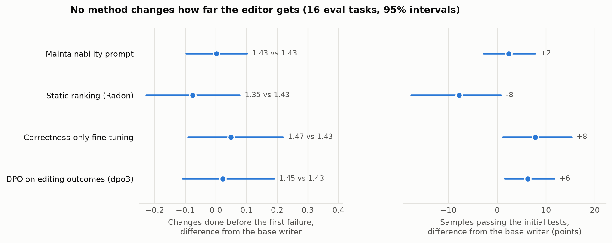

# Progress report, 2026-11-16

## The project in plain words

This section assumes no knowledge of the project. The rest of the report
gives the details.

### The question

Code is rarely written once and left alone. After a program is written,
people keep asking for changes: a new feature, a new rule, a fix. Some code
is easy to change, because it is organized so that a new feature fits in
one place. Other code is hard to change, because one small request means
touching many places, and something else breaks along the way.

AI models that write code are usually trained only to write code that works
today. Our question: **if an AI that writes code is trained on how easy its
code turned out to be to change later, does it learn to write code that is
easier to change?**

### The two AI models

- **The writer** is the model we try to improve. It is a coding model
  called Qwen2.5-Coder-7B ("7B" means it has 7 billion parameters, the
  numbers it learns). It gets a task description and writes a small Python
  program.
- **The editor** is a larger coding model of the same family
  (Qwen2.5-Coder-14B). It plays a programmer who comes along later. It gets
  the writer's program and a change request, such as "add discount codes",
  and edits the program. The editor is never trained or changed, so it
  treats every writer's code the same way. If it does better on one
  program than another, the difference comes from the code.

Both models run on one home graphics card (an RTX 5070 with 12 GB of
memory). They are stored in a compressed 4-bit form, so that both fit.

### The tasks

We wrote 60 small programming tasks, such as a bank ledger, a parking
garage, a library catalog or a shopping cart. Each task has:

- a description of the first version of the program;
- tests that check the first version works ("initial tests");
- a sequence of later change requests, 2 or 3 of them, each with its own
  tests. Some tests are shown to the editor ("public checks") and the rest
  are hidden, so the editor cannot just aim at the tests.

The tasks are split three ways, like in a school course:

- **36 training tasks** are used to collect training examples.
- **8 development ("dev") tasks** are used to choose training settings,
  like practice exams.
- **16 evaluation ("eval") tasks** are never used for training or for
  choosing settings. They are the final exam: the only fair test of
  whether a writer really got better.

Much of the early work went into making the tasks fair: fixing tests that
were wrong or unclear, so that a program fails only for real reasons.

### How a program is scored

1. The writer writes 16 versions of the program for a task.
2. The versions that pass the initial tests go on, at most 8 per task.
3. The editor applies the change requests one by one. After each change,
   all the tests run: the new feature must work, and nothing that worked
   before may break.
4. The program's score is **how many changes in a row the editor got
   done before the first failure**. On the eval tasks that is 0 to 3.
   This is the main number in this report: a higher number means code
   that was easier to change.

The editor does not give the same answer every time, so each program goes
through 2 different change sequences, 3 times each, and the results are
averaged.

### How the writer is trained

Take two working programs for the same task. If the editor clearly did
better with program A than with program B, that makes a **preference
pair**: A is preferred over B. From the 36 training tasks we collected
229 such pairs, and kept the 160 most reliable ones.

The training method is **DPO** (Direct Preference Optimization). It nudges
the writer to make programs like A more likely and programs like B less
likely. The writer has billions of parameters and the graphics card only
12 GB, so we train a small add-on to the model (a "LoRA adapter"), not the
whole model.

After training, the trained writer is compressed the same way as the
original. We checked that the conversion itself changes nothing, so any
difference in results comes from the training.

### What we compare

Five ways of producing a writer, all scored on the same 16 eval tasks with
the same editor:

1. **The original writer**, unchanged. This is the starting point.
2. **A maintainability prompt:** the original writer, asked in its
   instructions to write clean, maintainable code. This tests whether
   simply asking is enough.
3. **Ours:** the writer trained with DPO on the editing results.
4. **Static ranking:** the same training, except that programs are
   preferred by a standard code-quality formula (the Radon Maintainability
   Index) instead of by how the editor did. This tests whether a simple
   formula works as well as real editing results.
5. **Correctness-only:** the writer trained on its own working programs,
   with no preferences at all. This tests whether any gain comes simply
   from extra training on correct code.

### What we found so far

All five methods are done:

- **None of them makes the code easier to change.** The editor gets 1.43
  (original), 1.43 (maintainability prompt), 1.45 (ours), 1.35 (static
  ranking) and 1.47 (correctness-only) changes done before its first
  failure, out of 3. Those differences are smaller than the random
  variation between runs.
- **Our training does no better than plain training on the same
  programs.** The correctness-only writer saw the same working programs as
  ours, but not which ones were easier to change, and the two behave
  almost identically on every measure. So the editing results in our 160
  pairs had no effect we can detect.
- **Training on the writer's own working programs has a side effect:** it
  writes working programs more often. 64% of our writer's programs and 66%
  of the correctness-only writer's pass the initial tests, against 58% for
  the original, and both differences are too large to be chance. So this
  comes from the extra training on working code, not from our method. The
  static-ranking writer, trained on the formula's preferences, does not
  have it: only 50% of its programs pass.
- **Training too aggressively made the writer repetitive:** it kept
  writing the same few programs. A gentler setting fixed this, and that
  gentler version is the one we evaluated.
- **Comments make no difference.** We reran all five methods with every
  comment removed before the editor sees the code, and the results did not
  change. The writers rarely write comments unless asked for maintainable
  code, and our trained writer did not learn to add hints for the editor.
- **Why nothing shows up: the editor's luck.** The same program, given the
  same changes, often passes one time and fails the next. Within a task,
  95% of the differences in score come from this luck and about 4% from
  the program itself. The writer's programs are small (about 47 lines) and
  almost all built the same way, so there is little for training to find,
  and our 160 pairs mostly taught the writer to repeat them. Training
  tweaks cannot fix this; the tasks need to change (see "Why nothing shows
  up, in plain words").

- **A less random editor does not fix it.** With the editor's randomness
  turned down (temperature 0.2 instead of 0.7), the editor repeats itself
  a little more on the same changes, but which program does better still
  does not carry over to other changes. The program's share falls to 1%.
- **An editor that patches code instead of rewriting it does not fix it
  either.** Our editor model is bad at sending small edits: it finishes
  both changes 25% of the time instead of 53%, and the program's share is
  again 1%.
- **Tasks built for design to matter do not fix it with this editor.** We
  built three tasks with about 90-line programs whose bulk operations can
  either reuse the basic ones or repeat their logic, and changes that cut
  across every operation. The editor managed the main change for nearly
  every program, whichever way it was built, and failed undo for every
  program; the program's share is 0%.
- **A weaker editor does not fix it either.** A 7B editor finishes the
  first change 40% of the time instead of 72%, but which programs it fails
  on still does not carry over from one set of changes to another (program
  share 7%). A 3B editor almost never finishes a change.
- **The editor ignores the program's design unless asked to use it.** We
  wrote two programs by hand for the same spec. One changes its state
  directly. The other records every call in a log and rebuilds its state
  from it, so undo is just dropping the last entry. With the usual
  instructions, the editor wrote undo its own way for both, adding its own
  history next to the log. With one added paragraph asking it to build on
  what the program already has, it used the log: on one task, undo then
  worked 4 times in 6 for the log program and never for the other. This is
  the first case where a program's design decided whether a change worked.
  On the second task the editor broke both programs either way.
- **On the writer's own programs the new instructions help only a little.**
  Which program wins on one set of changes carries over to the other more
  often (75% instead of 59%), but the program's share is 7% and the
  held-out headroom +0.13. The writer's programs for a task all have the
  same design, so there is little for the editor to build on.
- **Programs built in different ways do not fix it either.** We had the
  writer draw its samples with a menu of 8 general design hints (an
  operation log, one method per kind of change, checks written once, a
  class per kind of thing, and so on). The programs did come out
  different, but the editor, with the new instructions, did about as well
  on all of them: the program's share is 2%, and no design did better than
  its task's average by more than chance.
- **How big the editor's edits are is not a usable label.** A program
  whose changes needed few lines or few functions on one set of changes
  needs as many as the others on the other set. Only the length of the
  editor's replies carries over a little, because it sends the whole file
  back, so shorter programs cost fewer words. That rewards short code, not
  better design.
- **An editor that has to work within the program does not fix it
  either.** Instead of the whole program, this editor sees an outline
  (every function's name, parameters and description, with the code
  hidden), asks for the code it needs, and sends back whole functions,
  which are put in place by name. Real maintainers of large codebases work
  like this. On the same 44 design-hinted programs it gets fewer changes
  done (0.94 per sequence instead of 1.23; the whole sequence works 32% of
  the time instead of 51%), and which programs it fails on is again luck:
  the program's share is 0% (0% to 4%), and the best program on one set of
  changes does no better on the other.
- **The editor hardly notices how readable a program is.** We gave it the
  same 51 dev programs as in the first dev run, made as unreadable as
  possible without changing what they do: no comments or docstrings, no
  blank lines, and private names, data attributes and local variables
  renamed to `_x1`, `a1`, `v1` and so on. Every trial used the same random
  seed as in the first run. The editor got 1.21 changes done per sequence
  instead of 1.25 (−0.04, −0.17 to +0.07), and the first change worked as
  often as before; only the whole sequence worked a little less often (47%
  instead of 53%). The writer's programs for a task differ in readability
  far less than a program and its obscured copy, so on these tasks better
  names, comments or layout from the writer cannot show up in the score.
- **A weaker editor does not rely on readable code either.** The same test
  with the 7B editor: 0.53 changes per sequence on the obscured programs
  against 0.50 on the readable ones (+0.03, −0.06 to +0.12). So readability
  is ruled out for both editors that fit on our GPU.
- **The program decides a few single changes, but a different few each
  time.** Taking one change at a time, on stock_portfolio's undo 4 programs
  always pass and 4 always fail. But in 43 of the 72 first changes on the
  train tasks every program does the same or the program explains nothing,
  and where a change does pick out programs, the task's other change picks
  others or none. So a pair's label comes from one change's edge case, not
  from a design the writer could learn to prefer.
- **A smaller writer is too weak to use.** A 3B writer, whose working
  programs might differ more, passes the initial tests with only 10 of
  its 120 dev programs (8%, against 55% for the 7B writer), and 7 of the 8
  dev tasks have at most one working program, so there is nothing to
  compare.
- **Labels as noisy as ours would hide even a preference that works.**
  The Radon writer learns its formula's preference, and it carries over:
  on pairs from the eval tasks it prefers the program the formula rates
  higher 79% of the time. Trained again with 15% of its 160 pairs swapped
  at random, it still does (75%). With 30% swapped, which makes the labels
  disagree with themselves about as often as our editing labels do, it no
  longer does (56%, 39% to 73%), and with 50% it is at chance. Its own
  programs say the same: with 15% swapped they score almost as much
  higher on the formula as the clean writer's (+0.39 against +0.43
  standard deviations), with 30% they do not move (+0.06).
- **But noise of our labels' kind does not stop training if it gets every
  pair.** Random swaps contradict each other (A over B, B over C, C over
  A). Our editing labels come from one noisy score per program, so they
  never do. A second control ranks programs by the formula plus noise
  drawn once per program, as unreliable as our editing scores (0.18).
  With dpo3's 160 pairs it is luck: one random seed carries the
  preference over (71%), another does not (58%). With every pair, 627,
  the writer prefers the higher-MI program 81% of the time, as with true
  labels, although 31% of its pairs point the wrong way. So our noise
  explains why 160 pairs were not enough to be sure; on its own it did
  not show that our labels point nowhere.
- **Our editing labels, given every pair, still teach nothing that
  carries over.** The same training on our editing labels, one mean
  editing score per program and all 634 pairs whose scores differ (the
  dpo_all writer), fits them tightly but ranks the base writer's held-out
  eval-task pairs only 54% right (49% to 61%), no better than the base
  model alone (56%). A writer that had learned their signal as well as the
  control learned the formula's would get about 65% on labels this noisy.
  With the same kind and amount of noise and the same number of pairs,
  training found the formula's preference and not ours. So what our
  editing scores share within a task does not point the same way across
  tasks.

### What is running now

Training seeds 2 and 3 of dpo3 and of the correctness-only writer, and
seed 2 of the Radon writer, on the original testbed are done (finding 35).
The second training round, its seeds 43 and 44 and the 32-sample prompted
control are done (findings 32 to 34), as are the third training seed of D
(finding 31), the foresight gates, which all failed (finding 30), and the
prompted control on all 10 eval tasks (finding 29).

**Training seeds of the original testbed** (`/home/pc/run_seeds.sh`, unit
`seeds`, resumed at 08:07 on 11-25). The proposal asks for three training seeds per
trained method. Seeds 2 and 3 of our DPO writer (dpo3), the
correctness-only writer and the Radon writer, each trained on the same
data with the same settings, served like the others and put through the
full eval collection (`configs/rtx5070_eval_dpo3_s2.yaml` and so on),
about 23 hours each. Both seeds of dpo3 and of the correctness-only
writer and Radon's seed 2 are done; Radon's seed 3, the last, started
training at 04:18 on 11-28. The script skips finished work, so it can be paused between
writers for other runs.

### Words used in the rest of this report

- **Change sequence:** the list of later change requests for a task.
- **Trial:** one run of the editor through one change sequence for one
  program.
- **Pass rate, or initial pass:** the share of the writer's programs that
  pass the initial tests.
- **"First change works", "whole sequence works":** how often the editor
  got the first change done, or all of them.
- **95% interval:** the range the true difference most likely lies in,
  given the random variation. If it includes 0, we cannot say the
  difference is real.
- **Learning rate:** how big each training step is. Too big, and the model
  overdoes it; too small, and it barely learns.
- **dpo2, dpo3:** our two trained writers, trained with a larger and a
  smaller learning rate; dpo3 is the one evaluated.

## Who did what

What has been done on the RTX 5070 machine since 2026-10-21 (Karin): the
tasks, the training data, DPO training, serving the trained writer, and the
first held-out results. It builds on the harness (Noah), the evaluation
tool (Thoomy), and the confidence intervals, static-ranking generator and
first training code (Riya). Pull requests #6 and #7 (2026-11-10) added
tests of the DPO training loop on a tiny CPU model and the code for the
comment ablation (`editor.view_transform: strip_comments`), whose runs on
all five writers followed (2026-11-12 to 11-13). Details and reproduce
commands are in the pages linked from each section; this report collects
them in one place.

## In short

- **The full pipeline runs end to end on one 12 GB GPU:** 60 tasks, writer
  sampling, editing trials, preference pairs, DPO training, a trained writer
  served exactly like the original, and held-out evaluation.
- **All five methods are done on the 16 eval tasks, and none makes the
  code measurably easier to change.** The editor gets through 1.43 of 3
  changes before its first failure with the original writer, 1.43 with the
  maintainability prompt, 1.45 with our DPO writer, 1.35 with the
  static-ranking (Radon) writer and 1.47 with the correctness-only writer.
  Every interval against the original includes 0.
- **Our DPO writer and the correctness-only writer cannot be told apart.**
  Fine-tuning on the same programs without preferences gives the same
  results on every measure (main measure +0.03, interval −0.05 to +0.10).
  The editing outcomes in our 160 pairs add nothing detectable.
- **The one clear effect of training is not the one it aimed for, and it
  is not ours.** Both writers trained on the writer's own passing programs
  pass the initial tests more often: 64% (ours, +2 to +12 points) and 66%
  (correctness-only, +1 to +15) against 58%. The Radon writer passes less
  often (50%).
- **No result depends on comments.** With every comment and docstring
  removed before the editor sees the code, no writer's main measure moves
  by more than 0.02. On the 52 programs that had any, the editor does
  about as well without them (−0.04, interval −0.26 to +0.19).
- **The testbed cannot show an effect yet, because the labels are mostly
  the editor's randomness.** Within a task, 95% of the variance of a
  trial's score on the train tasks is the editor (temperature 0.7), 4% the
  program. The best program on one change sequence is no better than
  average on the other (+0.03), and a pair's winner on one sequence wins
  on the other only 58% of the time. dpo3 ranks pairs it never saw 55%
  correctly (97% on its training pairs). Programs are about 47 lines and
  share one design in 30 of 36 train tasks. An editor at temperature 0.2
  does not help: on the dev tasks the program share is 1% (0% to 16%) and
  the held-out headroom −0.00. Neither does an editor that sends
  SEARCH/REPLACE edits instead of whole files: the 14B editor handles the
  format poorly (whole sequence 25% against 53%, −43 to −13 points), and
  the program share is again 1% (0% to 16%).
  [Diagnostics](../harness/results/diagnostics.md).
- **The score barely notices readability at all.** With every dev program
  obscured (no comments or docstrings, meaningless names), the editor gets
  1.21 changes per sequence against 1.25 (−0.04, −0.17 to +0.07), and the
  7B editor no more (+0.03, −0.06 to +0.12). A smaller (3B) writer is no
  way out: only 8% of its dev programs pass the initial tests, too few to
  compare.
- **Noise like ours hides a preference in 160 pairs, but not in all of
  them.** Trained with 30% of its 160 pairs swapped at random, the Radon
  writer no longer prefers the higher-MI program on eval-task pairs (56%,
  39% to 73%, against 79% with true labels), and its eval programs no
  longer score higher on the formula (+0.06 SD, against +0.43). With noise
  of our labels' kind and size instead (one noisy score per program,
  reliability 0.18), 160 pairs give 58% or 71% depending on the random
  seed, and all 627 pairs give 81%, as good as true labels. dpo3 trained
  on 160. The same all-pairs training on our editing labels (634 pairs)
  carries nothing over: 54% (49% to 61%) of held-out eval-task editing
  pairs, where a writer that had learned their signal as well would get
  about 65%. So the noise is not what stops training; our labels have no
  direction in common across tasks. Its full eval run is going.

## The five methods

| Method | Status | Changes done before first failure (of 3) | First change works | Whole sequence works | Samples passing initial tests |
|---|---|---:|---:|---:|---:|
| Original writer | done | 1.43 | 67% | 26% | 58% |
| Maintainability prompt | done | 1.43 | 70% | 25% | 60% |
| Ours (DPO on editing outcomes, dpo3) | done | 1.45 | 71% | 25% | 64% |
| Static ranking (DPO on Radon MI) | done | 1.35 | 67% | 23% | 50% |
| Correctness-only (fine-tuning on passing programs) | done | 1.47 | 72% | 25% | 66% |

All rows use the same 16 eval tasks, the same frozen editor
(Qwen2.5-Coder-14B), budget and selection. The selection is the writer's
passing programs, at most 8 per task in sample order, each given 2 change
sequences × 3 repetitions. Differences from the original writer, from a
paired bootstrap over the 16 tasks:

| Method | Changes done before first failure | First change works | Whole sequence works | Samples passing initial tests |
|---|---|---|---|---|
| Maintainability prompt | +0.00 (−0.10 to +0.10) | +3 pts (−1 to +8) | −1 pt (−5 to +4) | +2 pts (−3 to +8) |
| Ours (dpo3) | +0.02 (−0.11 to +0.19) | +4 pts (+0 to +9) | −1 pt (−6 to +5) | +6 pts (+2 to +12) |
| Static ranking | −0.08 (−0.23 to +0.08) | +0 pts (−6 to +8) | −3 pts (−8 to +1) | −8 pts (−18 to +1) |
| Correctness-only | +0.05 (−0.09 to +0.22) | +5 pts (+1 to +10) | −1 pt (−7 to +6) | +8 pts (+1 to +15) |

Against ours (dpo3), same measures in the same order:

| Method | Changes done before first failure | First change works | Whole sequence works | Samples passing initial tests |
|---|---|---|---|---|
| Static ranking minus ours | −0.10 (−0.35 to +0.11) | −4 pts (−11 to +3) | −3 pts (−10 to +3) | −14 pts (−24 to −5) |
| Correctness-only minus ours | +0.03 (−0.05 to +0.10) | +1 pt (−2 to +4) | −0 pts (−2 to +2) | +2 pts (−5 to +8) |

Pages: [original writer](../harness/results/base_writer_eval.md),
[maintainability prompt](../harness/results/maintainability_prompt_eval.md),
[ours](../harness/results/dpo3_eval.md),
[static ranking](../harness/results/radon_eval.md),
[correctness-only](../harness/results/sft_eval.md).

## The two trained baselines, in plain words

Both ran on the RTX 5070 machine, one after the other: static ranking from
2026-11-10 05:00 to 2026-11-11 03:54 PST (run 20261110T134603Z-31b2e3),
correctness-only from 2026-11-11 03:55 to 2026-11-12 03:34 PST (run
20261111T122905Z-5cae35). Nothing is running now.

A baseline is a simpler alternative that our method is compared against,
to see whether learning from real editing results is worth its cost. Both
of these were planned in the proposal from the start. They are part of the
five-method comparison, not new attempts after the first results.

**1. Static-ranking baseline (Radon)**

- **The idea:** instead of watching an editor change the code, a fixed
  formula judges which program is "more maintainable". Radon is a standard
  tool that scores code from things like length and complexity.
- **How it was trained:** exactly like dpo3, with the same 28 tasks, the
  same number of pairs (160), the same training settings and the same
  conversion. The only difference is who decided which program in each
  pair was better: the formula instead of the editor. If it does as well
  as dpo3, a cheap formula could replace our expensive editing step.
- **The terms used for it:**
  - `configs/rtx5070_eval_radon.yaml` is the settings file for this run.
  - `20261110T134603Z-31b2e3` is the run's ID: its start time plus a
    random tag. It is how its results are found in the database later.
  - "Loss 0.54 at the last step (dpo3: 0.55)" is a training progress
    number. The two being so close means both trainings went about
    equally far, which keeps the comparison fair.
  - "Passed the same export checks" means it was converted for Ollama the
    same verified way as dpo3, so the conversion did not change anything
    by accident.
- **The result (finished 2026-11-11):** it did no better than the original
  writer. The editor got 1.35 changes done before its first failure,
  against 1.43 (difference −0.08, interval −0.23 to +0.08), and fewer of
  its programs passed the initial tests (50% against 58%). Its programs
  score only slightly higher on the formula itself (43.5 against 42.6 out
  of 100), about as much as just asking for maintainable code. Against
  dpo3 the main measure cannot be told apart either (−0.10, interval −0.35
  to +0.11). Because neither trained writer beat the original, this
  comparison cannot yet say whether real editing results are a better
  training signal than the formula. Its pass rate is 14 points below
  dpo3's, although both were trained on pairs of working programs.
  Together with the correctness-only result below, this suggests the
  formula's preferences work against the pass rate, while training on the
  writer's own working programs lifts it.

**2. Correctness-only baseline**

- **The idea:** no preferences at all. The writer is simply trained on its
  own programs that worked, 201 of them from the same 28 tasks.
- **Why it matters:** dpo3's one clear effect was writing working programs
  more often (64% vs 58%). This baseline tests whether that comes from our
  method or just from extra training on correct code. If this one gets the
  same boost, the boost is not special to our method.
- **The steps:** 16 minutes of training, about 15 minutes converting the
  model ("export", with the same checks as dpo3), then 23 hours on the
  eval tasks.
- **The result (finished 2026-11-12):** it got the same boost. 66% of its
  programs pass the initial tests, against 58% for the original (interval
  +1 to +15 points) and 64% for dpo3. On every measure it is as good as
  dpo3: 1.47 changes done before the first failure against dpo3's 1.45
  (difference +0.03, interval −0.05 to +0.10), and the first change works
  72% of the time against 71%. So the boost is not special to our method,
  and the preferences in our 160 pairs (which program the editor found
  easier to change) made no difference we can measure. Its programs are a
  little less varied: 234 different programs among 256 samples, against
  252 for the original and dpo3.

## The comment test, in plain words

- **The worry:** a writer could "win" without writing better-organized
  code, by leaving comments that tell the editor what to do. The proposal
  plans this check: rerun the evaluation with all comments removed before
  the editor sees the code. If a method's results drop, its advantage came
  from the comments.
- **How it ran:** all five methods, on the same programs, from 2026-11-12
  03:47 to 2026-11-13 07:16 PST (27.5 hours). Most programs have no
  comments at all. The editor sees exactly the same thing for those as in
  the normal run, so their results were reused from the store instead of
  asking the editor again (all 2,904 of these trials came out identical,
  as they should). Only the 52 programs with comments needed new editing.
  That made it about a day instead of five.
- **The result (finished 2026-11-13):** nothing changes.

  | Method | Programs with comments | Changes done before first failure, normal → no comments |
  |---|---:|---:|
  | Original writer | 4 of 110 | 1.43 → 1.41 |
  | Maintainability prompt | 32 of 108 | 1.43 → 1.44 |
  | Ours (dpo3) | 5 of 113 | 1.45 → 1.45 |
  | Static ranking | 8 of 94 | 1.35 → 1.35 |
  | Correctness-only | 3 of 111 | 1.47 → 1.48 |

  Only the maintainability prompt makes the writer comment much (a third
  of its programs), and the editor does just as well without those
  comments. Our writer comments as rarely as the original, so it did not
  learn to leave hints. Page:
  [comment ablation](../harness/results/nocomments_eval.md).

## Why nothing shows up, in plain words

Four checks on the results we already have (2026-11-13), to find out
whether the problem is the test, the training signal or the training:

- **Is there room to improve at all?** For each task, take the program
  that did best on one list of changes and see how it does on the other
  list. On the train tasks it does no better than average (+0.03 changes).
  On the eval tasks it does somewhat better (+0.15 to +0.27), but a writer
  that only leans towards its better programs would gain under 0.1, less
  than this eval can detect.
- **Do winners stay winners?** If program A beats program B on one list of
  changes, does it also beat B on the other? Only 58% of the time, close
  to a coin flip. Even two runs of the same list agree only 60% of the
  time.
- **Did our writer learn anything that carries over?** On pairs it never
  saw, it prefers the winner 55% of the time (63% on eval tasks, 36% on
  dev tasks), against 97% on the pairs it was trained on. It mostly
  memorized its training pairs.
- **What do winners look like?** No code feature (length, number of
  functions, complexity, Radon score, comments, ...) tells winners from
  losers consistently, and our writer's code did not change on any of
  them. The Radon writer's code did change, on exactly the features its
  formula rewards, so training works when the labels are consistent.

**The reason:** the editor is random enough (temperature 0.7) that the
same program, given the same changes, often succeeds once and fails the
next time. 95% of the differences in score within a task come from this,
and 4% from the program. The programs are about 47 lines long, nearly all
built the same way (the task fixes the methods), and the editor rewrites
whole files, so how a program is organized barely matters to it.

**Is it just the editor's temperature?** No. We reran the dev tasks with
the editor at temperature 0.2. It got the same results and repeated
itself a little more on the same changes, but a program that did well on
one set of changes still did no better on the other. Only 1% of the
differences came from the program. Most of the luck stayed.

**Is it because the editor rewrites whole files?** We can't tell yet. We
made the editor send small search-and-replace edits instead, so it has to
work within the existing code. The editor model is bad at this: it sends
too many edits at once, gets cut off, or tries to edit code that isn't
there yet. It finished both changes 25% of the time instead of 53%. Again
only 1% of the differences came from the program, but with this many
format mistakes the run can't tell whether a better patching editor would
help.

**What it means:** more seeds or other training settings cannot help. The
tasks need to make the program matter: bigger programs with room for
different designs, changes that cut across the design, an editor that
works within the existing code (which needs a stronger editor or a
simpler edit format than search-and-replace), and a check with these
diagnostics on a few pilot tasks before more training. Page:
[diagnostics](../harness/results/diagnostics.md).

## What was done

### Tasks (2026-10-21 to 2026-11-05)

- Added the 60 task families: 8 dev (2 new plus the 6 that existed), 36
  train and 16 eval. `harness/tasks/FAMILIES.md` documents each family and
  every change below.
- **Writer check:** a task is usable only if enough of the writer's samples
  pass its initial tests, and many first failed it. Two kinds of fix, applied
  the same way everywhere:
  - Input checks the writer skips anyway were made unspecified (True as a
    number, non-string names other than `""` and `None`, which error comes
    first). Their hidden tests went with them.
  - Behaviour the writer kept getting wrong was stated more plainly, with
    examples.
- **Redesigns:** some tasks were redesigned to fit what the writer does
  anyway: robot_fleet, hangman_games, ticket_desk, iou_tracker and
  pantry_inventory (three times each for the last two), 8 of the eval
  tasks, and library_catalog. All 60 tasks now pass the writer check.
- **Change tests:** these were brought in line with the same rules. Then
  the checks were rerun on the final program of every failed editing step.
  Where nearly every failure missed a rule that the change request states
  but no public check covered, a small public check was added (15 in eval
  tasks, 11 in train tasks, and some in dev tasks). Each new check passes
  every step that succeeded before. Changes that are only hard were left
  alone.

### Settings (2026-10-26 to 2026-11-01)

All are listed under "Changes from the proposal" in the README. The main
ones:

- **Hardware:** everything runs on an RTX 5070 (12 GB), not the RTX 5090.
  The writer (Qwen2.5-Coder-7B) and the editor (Qwen2.5-Coder-14B) are both
  4-bit in Ollama, with an 8192-token context.
- **Programs edited per task:** 16 writer samples per task, of which the
  first 8 distinct passing programs are edited. With 8 samples, too few
  programs passed to reach 100–300 pairs.
- **Pairing:** `all_pairs`, at most 8 pairs per task. A pair needs the
  chosen program to complete at least 2 more changes than the rejected one,
  summed over sequences and repetitions (`min_step_gap: 2`).
- **Scoring:** a program scores changes completed in a row, with no partial
  credit, and the editor gets 8 turns. Writer temperature is 0.4.
- **Dev calibration:** 53 pairs from 130 comparisons, a tie rate of 0.23,
  repetition agreement of 0.84 and 47 seconds per editing step.
- **Infrastructure:** program files are now flushed to disk before they are
  recorded, after two WSL crashes left empty files. The README explains how
  to run under WSL on Windows without those crashes.

### Training data (train collection)

- 36 train tasks × 16 samples = 576 writer programs. 256 were edited, 177
  failed the initial tests, 46 were duplicates and 97 were over the
  8-program cap.
- 2,679 editing steps gave 821 comparisons and 229 pairs from 31 tasks (tie
  rate 0.19, repetition agreement 0.84).
- Filtering (`scripts/filter_pairs.py`) gives the training file:
  - pairs whose chosen program wins in at least 2 of the 3 repetitions:
    182;
  - minus cosmetic pairs, whose two programs are the same code apart from
    strings, docstrings, local names and annotations: **160 pairs from 28
    tasks**.

### DPO training (2026-11-08)

- `harness/src/harness/train_dpo.py` now runs its own DPO loop. TRL's
  trainer ran out of memory at 12 GB, because it computes the whole
  vocabulary's scores at every position.
- Setup: QLoRA (4-bit NF4), LoRA rank 16 on every linear layer, beta 0.1,
  2 epochs, 8 pairs per step. A run takes about 25 minutes and peaks at
  8.3 GB.

### Serving the trained writer exactly like the original (2026-11-08)

Ollama cannot load LoRA adapters, and the original writer is the official
Q4_K_M file. So the adapter is merged into the weights
(`scripts/merge_lora.py`) and converted with llama.cpp:

- conversion goes through f16 (the official file was made from f16);
- quantization reuses the official file's per-tensor types
  (`scripts/gguf_quant_types.py`);
- metadata the official file does not have is dropped.

**Check:** the untrained model sent through this route reproduces the
official file byte for byte. A trained writer's 143 tensors that LoRA does
not touch are identical to the official ones, and all 196 trained ones
differ. So any difference in results comes from training, not from
conversion. README, "Serving the trained writer".

### Choosing the training settings on the dev tasks (2026-11-08 to 11-09)

Only the learning rate was varied; the eval tasks were not touched.

| | Original | dpo2 (lr 5e-5) | dpo3 (lr 2e-5) |
|---|---:|---:|---:|
| Changes done before first failure (of 2) | 1.25 | 1.21 | 1.29 |
| First change works | 72% | 70% | 74% |
| Whole sequence works | 53% | 52% | 55% |
| Distinct programs among 128 samples | 113 | 101 | 114 |

- **lr 5e-6:** barely trained. The loss stayed at 0.68 after 2 epochs.
- **dpo2, lr 5e-5:** over-optimized. Training loss fell to 0.21, and the
  writer repeated itself: course_enrollment's 15 passing samples were only
  4 different programs, and library_catalog passed 1 of 16.
- **dpo3, lr 2e-5:** kept the original's variety and was slightly ahead
  (+0.04, interval −0.07 to +0.14), so it went to the eval tasks.

Pages: [dpo2](../harness/results/dpo2_dev.md),
[dpo3](../harness/results/dpo3_dev.md),
[original](../harness/results/base_writer_dev.md).

### The two trained baselines (2026-11-10 to 11-12)

Both see the same 28 train tasks and use dpo3's training settings, so only
the training signal differs:

- **Static ranking:** prefers the program with the higher Radon
  Maintainability Index. `scripts/static_ranking.py` gives 271 pairs, and
  `scripts/match_pairs.py` keeps as many per task as ours has (160).
  - 33 of the 160 are pairs of ours with the same winner;
  - 22 are pairs of ours with the opposite winner;
  - 105 are pairs ours does not have.

  Its training fit the formula's preferences more easily than ours fit
  the editing ones: by the second epoch, mean loss 0.55 against 0.61 and
  reward accuracy 99% against 96%.
- **Correctness-only:** supervised fine-tuning
  (`harness/src/harness/train_sft.py`) on the 201 passing programs these
  tasks' pairs were built from (`scripts/sft_programs.py`). It sees the same
  programs as our writer but not which were easier to change. 51 steps in
  16 minutes; the loss per program token fell from 0.051 to 0.019.

### Comment ablation (2026-11-12 to 11-13)

- One config per writer (`configs/rtx5070_eval*_nocomments.yaml`): the
  normal eval config plus `editor.view_transform: strip_comments`, which
  removes every comment and docstring before a sequence's first step.
- Programs with nothing to strip give the editor the same prompt with the
  same seed, so their trials replay from the stored replies. All 2,904 of
  them match the normal run step for step (status and output program;
  `scripts/ablation_compare.py`). The five runs needed 1,980 new editor
  calls, about a tenth of the five normal runs' 20,078.
- One trial hit a Docker error and was retried by rerunning its config.

### Diagnostics (2026-11-13)

- `scripts/diagnostics.py`: headroom (best program by one sequence, scored
  on the other), how often winners agree across sequences and repetitions,
  and a variance decomposition of trial scores (program, program ×
  sequence, trial), also for other measures of the first change.
- `scripts/implicit_reward.py`: DPO's implicit reward of the four adapters
  on the training pairs and on the base writer's dev-task and eval-task
  pairs (forward passes, 2.5 hours on the GPU).
- `scripts/winner_features.py`: 23 static features, their within-task
  correlation with the editing score, a leave-one-task-out pair
  classifier, and how far each trained writer's programs moved on them.
- Fixed: a resample in which no pair was decided on both sides gave an
  undefined share that broke the sort of the bootstrap. Every interval
  in the diagnostics page is unchanged; only the small dev-task runs drew
  such resamples.

### Editor-temperature probe (2026-11-13)

- `configs/rtx5070_pc_editor_t02.yaml`: the 8 dev tasks' programs edited
  again with the editor at temperature 0.2 instead of 0.7. Run
  20261114T014031Z-9433c1: 343 steps, 1,059 editor calls, 0 infrastructure
  errors, about 6.5 hours (paused for 3 hours on request).
- Same results on the changes (−0.03, −0.14 to +0.06). Two repetitions of
  the same sequence pick the same winner more often (68% against 50%), but
  winners on one sequence are a coin flip on the other (49%), the program
  share falls from 4% to 1% (0% to 16%), and the held-out headroom from
  +0.12 to −0.00.

### Patch-editor probe (2026-11-13 to 11-14)

- `editor.edit_format: search_replace` (`models/patch.py`,
  `prompts/editor_patch_v1.md`): the editor sends SEARCH/REPLACE edits of
  the current files instead of whole files. Off by default; the editor key
  of every existing config is unchanged.
- The format went through three versions on one dev task: edits applied
  one by one instead of all or nothing, a message for edits that quote
  code not yet in the file, and a worked example in the prompt.
- `configs/rtx5070_pc_editor_patch.yaml`: the same 51 dev-task programs.
  Run 20261114T075822Z-4da442: 482 steps, 1,889 editor calls, 0
  infrastructure errors, about 10 hours.
- Much worse on the changes: the whole sequence works 25% of the time
  against 53% (−43 to −13 points). Per step, 3.9 editor calls against 2.2,
  out of turns 22% against 10%, and 6% of replies cut off at the length
  limit (none for whole files). Program share 1% (0% to 16%), winners on
  one sequence win on the other 48% of the time, held-out headroom +0.05
  (−0.22 to +0.32).

### Design-sensitive pilot (2026-11-14)

- Three new dev tasks (`tasks/fuel_depot`, `tasks/herd_paddocks`,
  `tasks/sample_freezers`): primitives plus composite operations that move
  everything from one place to another, whose construction the spec leaves
  open, and changes that cut across every operation (a capacity or
  allowed-species rule, a flag that blocks every move, undo).
  `configs/rtx5070_pilot.yaml` and `configs/rtx5070_pilot_maintain.yaml`
  (the plain and the maintainability prompt).
- The first version passed 0 of 96 writer samples because of spec traps
  unrelated to design (re-adding removed ids, the order of `KeyError` and
  `ValueError`, type checks, an inconsistent parameter name, the order of
  moved items). After fixing them, 25 of 96 passed.
- Editing them failed the gate: 5 of 137 steps work, program share 0%,
  held-out headroom +0.00. The failing hidden tests are again edge rules
  (zero-sized moves, error order). Re-graded without those, the capacity
  and allowed-species changes work in about 85% of trials for programs
  built either way, and undo fails for every program.
- `scripts/diagnostics.py` no longer crashes when no task's scores vary.

### Editor-size probe (2026-11-14 to 11-15)

- `configs/rtx5070_pc_editor_7b.yaml` and `configs/rtx5070_pc_editor_3b.yaml`:
  the same 51 dev-task programs edited by Qwen2.5-Coder-7B (run
  20261115T040402Z-94b9a5, 428 steps, about 5 hours) and Qwen2.5-Coder-3B
  (run 20261115T091404Z-24e38f, 316 steps, about 3 hours).
- 7B: first change works 40% (14B: 72%); program share 7% (0% to 19%),
  program × sequence 7%, held-out headroom +0.03 (−0.10 to +0.16).
- 3B: first change works 3%; 284 of 316 steps run out of turns.

### Design probe (2026-11-15)

- `scripts/design_probe.py` takes hand-written programs for a task through
  its change sequences with the editor, in a store of its own. The programs
  and every trial are in `harness/results/design_probe/`: a `state` and a
  `log` program each for sample_freezers and herd_paddocks.
- Prompt v2, both sequences, 6 reps: the `log` program passes undo in 1 of
  6 on each task and the `state` program in 0. Of the editor's 77 undo
  methods for the `log` programs, 35 keep a stack of their own, 42 use the
  log but add inverse operations or copies, and none just drops the last
  entry and rebuilds.
- `prompts/editor_v3.md` (`configs/rtx5070_pilot_editor_v3.yaml`) adds one
  paragraph: build the change on the program's existing design rather than
  next to it, and keep it as small as that design allows. Undo first
  (sequence s2), 6 reps: herd_paddocks `log` 4 of 6, `state` 0 of 6
  (one-sided Fisher p = 0.03); 10 of its 31 undo methods for the `log`
  program are the two-line version. sample_freezers: 0 and 0. The editor
  breaks existing behavior for both programs and runs out of turns.
- `configs/rtx5070_pc_editor_v3.yaml`: prompt v3 on the 51 dev-task
  programs (run 20261115T145931Z-d53335, 516 steps, about 6 hours). First
  change works 69% (v2: 72%); program share 7% (4% to 10%; v2: 4%);
  winner on A also wins on B 75% (64% to 86%; v2: 59%); held-out headroom
  +0.13 (+0.05 to +0.21; v2: +0.12).
- `writer.design_hints` (`config.py`, `collection/collect.py`): sample i is
  sent the writer prompt with hint i mod the number of hints added as a
  "Design" section, while candidates and pairs keep the plain prompt.
  `scripts/hint_summary.py` reports how each hint's programs fare against
  their task's average. `configs/rtx5070_pc_hints.yaml` is the dev probe
  with 8 hints and prompt v3 (run 20261115T211638Z-3f73df, 335 steps, about
  5 hours): 52 of 124 distinct programs pass the initial checks (3 to 8 of
  16 samples per hint, 11 without one), 44 edited. First change works 74%;
  program share 2% (0% to 7%); winner on A also wins on B 53% (36% to 69%);
  held-out headroom +0.02 (−0.16 to +0.16). Against the task mean, the
  best hints are a class per kind of thing (+0.24, +0.00 to +0.69, 3
  programs) and rules as data (+0.09, −0.11 to +0.39).
- `scripts/edit_carryover.py`: whether the lines changed, tokens written
  and existing functions modified by successful steps carry over between
  sequences. On the train tasks the program with the smallest edits on one
  sequence is at −0.005 log lines (−0.025 to +0.015), −0.055 log tokens
  (−0.114 to +0.004) and −0.06 functions (−0.12 to +0.01) on the other;
  the dev configs are alike (`harness/results/diagnostics.md`).
- Programs with a public method that changes data and calls another (what
  breaks a snapshot-per-method undo): 13 of 353 train programs, all
  robot_fleet; none of the dev programs. So a general undo change was not
  built.

### Outline editor (2026-11-15)

- `editor.edit_format: functions` (`models/outline.py`,
  `prompts/editor_outline.md`, `collection/editor.py`): the program is
  shown as an outline with function bodies hidden; `SHOW <names>` opens
  them; complete functions, methods and classes are spliced in by name. A
  def that would replace a hidden one not opened in an earlier turn, or
  whose body is only `...`, is skipped with a message; SHOW lines count
  inside code blocks too. Whole-file and SEARCH/REPLACE keys are unchanged;
  the format adds its own protocol version to the editor key.
- Smoke tests on bank_ledger: without the opened-first rule the editor
  rewrote whole classes from the outline and ran out of turns; with it, 7
  of 8 steps work (2 programs × 2 sequences), at 6.5 calls per step.
- `configs/rtx5070_pc_outline.yaml`: the dev probe on the hints run's
  programs, 10 turns per step (run 20261116T031616Z-73eee1, 440 steps,
  2,650 editor calls, about 10 hours, 0 infrastructure errors). Against
  the whole-file editor on the same programs: 0.94 changes per sequence
  against 1.23 (−0.29, −0.49 to −0.10), whole sequence 32% against 51%;
  program share 0% (0% to 4%), program × sequence 14%, winners agree
  across sequences 49%, held-out headroom −0.01 (−0.14 to +0.10). Fails
  the gate, so `configs/rtx5070_train_outline.yaml` and
  `configs/rtx5070_eval_outline.yaml` (drafted for a rerun) were not run.

### Readability control (2026-11-16)

- `editor.view_transform: obscure` (`collection/view.py`): before a
  sequence's first step, comments, docstrings and blank lines go, and
  private names, data attributes (names only ever set as `self.x = ...`)
  and local variables are renamed to `_x1`, `a1`, `v1`. Public functions,
  classes and methods, parameters, keywords, imports, class attributes and
  attribute names of builtin types stay. Tests: a program behaves the same
  before and after, and every task's reference and planted-bug programs
  keep their public interface.
- `scripts/obscure_check.py`: all 51 of the first dev run's programs pass
  their initial tests once obscured (on average 0.4 private names, 1.7
  data attributes and 0.8 local variables renamed per program).
- `configs/rtx5070_pc_obscure.yaml`: the same programs, editor and seeds as
  `rtx5070_pc.yaml`, with the obscured view (run 20261116T133752Z-e9bd81,
  306 trials, 536 steps, 1,134 editor calls, 6 hours 20 minutes, 0
  infrastructure errors). On average 7% of each program's bytes go. The
  dev tasks' change tests read no data attribute, so the renaming cannot
  fail them by itself. Against the readable programs: 1.21 changes per
  sequence against 1.25 (−0.04, −0.17 to +0.07; the same trial by trial,
  `scripts/ablation_compare.py`), first change 73% against 72%, whole
  sequence 47% against 53% (−6 points, −11 to −2, mostly bank_ledger and
  parking_garage); program share 0% (0% to 5%), held-out headroom +0.05
  (−0.01 to +0.14).
- `configs/rtx5070_pc_writer_3b.yaml`: the dev run with Qwen2.5-Coder-3B
  as the writer (run 20261116T195823Z-de1d3b, 128 samples, 118 steps, 1
  hour 24 minutes, 1 infrastructure error). 10 of 120 distinct programs
  pass the initial tests (shopping_cart 8, course_enrollment 1,
  team_roster 1, the other five tasks 0), and 7 replies did not parse. The
  failures are real mistakes (lists never created, checks in a different
  order from the spec's). Only shopping_cart has two or more passing
  programs, and they all score the same: 0 pairs. Fails the gate, so the
  3B rerun was not started.
- `configs/rtx5070_pc_editor_7b_obscure.yaml`: the readability control
  with the 7B editor, paired trial by trial with
  `rtx5070_pc_editor_7b.yaml` (run 20261116T212312Z-963d55, 306 trials,
  435 steps, 1,819 editor calls, 5 hours 32 minutes, 0 infrastructure
  errors). 0.53 changes per sequence against 0.50 (+0.03, −0.06 to +0.12;
  the same trial by trial), first change 41% against 38%, whole sequence
  12% against 11%; program share 0% (0% to 1%), winners agree across
  sequences 36%, held-out headroom −0.06 (−0.14 to −0.01).
- `scripts/step_effects.py`: each first change on its own, with each
  program's working repetitions and a one-way program share. Train: of 72
  first changes, 20 have no variance (18 every program passes, 2 none
  does), 23 a share of 0, 20 below 25%, 9 of 25% or more (3 of 50% or
  more); dev 6, 4, 4, 2 of 16; eval 4, 16, 6, 6 of 32.
- `scripts/flip_pairs.py`: the label-noise control. 24, 48 and 80 of the
  160 matched Radon pairs swapped (seed 20261116), each trained with
  dpo3's settings (`/home/pc/models/dpo/radon_f15`, `radon_f30`,
  `radon_f50`; final loss 0.59, 0.67, 0.67, against 0.54 for radon and
  0.55 for dpo3). Held-out Radon pairs from `scripts/static_ranking.py` on
  the base writer's dev (60) and eval (114) programs. Implicit reward on
  the eval-task pairs (`scripts/implicit_reward.py`): radon 79% (67% to
  89%), radon_f15 75% (61% to 86%), radon_f30 56% (39% to 73%), radon_f50
  40% (26% to 55%), dpo3 46%, sft 46%. The dev-task pairs (8 tasks) cannot
  tell them apart (57% to 68%, intervals about 40 points wide).
- `configs/rtx5070_eval_radon_f15.yaml`, `_f30`, `_f50`: the three noisy
  writers, served like the others, sampled on the 16 eval tasks with
  `--until initial` (runs 20261117T054842Z-813093, 20261117T064853Z-e6acef,
  20261117T074816Z-271d39; 256 samples each, 0 infrastructure errors).
  `scripts/winner_features.py`: Radon MI of passing programs +0.39 (+0.07
  to +0.83), +0.06 (−0.08 to +0.20), +0.14 (−0.09 to +0.52) base SDs;
  radon +0.43. Initial pass 57%, 65%, 60% (base 58%, radon 50%).
- `scripts/static_ranking.py --score-noise R` and `--no-cap`: rank by MI
  standardized within each task times √R plus Gaussian noise times
  √(1 − R), per program; pairs record both programs' MI. R = 0.18 (seeds
  20261116 and 2), 0.47 and 0.80, matched to dpo3's 160 pairs (119, 125,
  143 and 159 of them prefer the higher-MI program), and 0.18 uncapped
  (627 pairs, 433), each trained with dpo3's settings
  (`/home/pc/models/dpo/radon_rel18`, `radon_rel18s2`, `radon_rel47`,
  `radon_rel80`, `radon_rel18_all`; final loss 0.55, 0.55, 0.54, 0.52,
  0.59; 2026-11-17 00:33 to 04:21 PST). Implicit reward on the eval-task
  Radon pairs (`runs/rtx5070_pc/dpo/implicit_reward_scorenoise.jsonl`):
  58% (42% to 73%), 71% (54% to 86%), 74% (57% to 87%), 81% (68% to 92%),
  81% (66% to 92%); radon 79%, radon_f30 56%. Dev-task pairs 47% to 68%,
  no separation.
- `scripts/diagnostics.py` no longer fails when every trial of a measure
  gets the same score.

### All-pairs editing writer (2026-11-17)

- Scorer rule `aggregate` (`collection/scorer.py`): the higher mean score
  over sequences wins even if one sequence disagrees, so each program has
  one score and a task's pairs never contradict each other.
  `configs/rtx5070_train_aggregate.yaml` (rule `aggregate`, no per-task
  cap, min step gap 1) rebuilds the train collection's pairs from the
  store: 634 pairs from 36 tasks, against 627 for the control's all-pairs
  writer. `configs/rtx5070_dev_aggregate.yaml` and
  `rtx5070_eval_aggregate.yaml` give the base writer's held-out editing
  pairs paired the same way (98 from 7 dev tasks, 298 from 16 eval tasks).
- `/home/pc/run_dpoall.sh`: dpo_all trained on the 634 pairs (none too
  long) with dpo3's settings (`/home/pc/models/dpo/dpo_all`, 159 steps,
  final loss 0.33, reward margin +1.11; 05:02 to 06:37 PST). Implicit
  reward of dpo3, dpo_all, radon and radon_rel18_all on those held-out
  pairs and the Radon eval pairs
  (`runs/rtx5070_pc/dpo/implicit_reward_dpoall.jsonl`, 07:47): dpo_all
  54% (49% to 61%) eval, 47% (29% to 66%) dev, 47% Radon; base model
  log-probability 56%, 57%; dpo3 52%, 37%.
- `scripts/noise_ceiling.py`: what a writer that learned a signal would
  score on held-out labels this noisy. radon_rel18_all over every pair of
  the 106 Radon eval programs: 71% against MI, 65% (58% to 71%) against MI
  plus per-program noise at reliability 0.42, 60% (51% to 67%) at 0.18.
- dpo_all exported as writer-dpo_all-ctx8k and run through the full eval
  collection (`configs/rtx5070_eval_dpo_all.yaml`): run
  20261117T160216Z-85a677, stopped at 11 of 16 tasks on 11-17 19:39 for
  the history suite, resumed as 20261119T160709Z-54f9b9 (08:07 to 12:43
  on 11-19). 979 editing steps, no infrastructure errors. No sample passes
  the initial checks on rover_fleet or task_board, so 14 paired tasks:
  against the base writer −0.00 changes before the first failure (−0.11
  to +0.12), first change +4 pts (−1 to +8), pass rate −13 pts (−26 to
  +0); against dpo3 −0.03 (−0.19 to +0.09), pass rate −20 pts (−32 to
  −8).
- radon_rel18_all exported and sampled on the eval tasks
  (`configs/rtx5070_eval_radon_rel18_all.yaml`, `--until initial`, run
  20261119T210109Z-858d35, 13:01 to 13:49), then
  `scripts/winner_features.py` (`/home/pc/dpoall_shifts.md`). Its passing
  programs score +0.58 base standard deviations higher on MI (+0.16 to
  +1.11; the clean radon writer +0.43, +0.04 to +0.88), and are shorter
  (−1.11 SD lines of code, −1.11 SD duplicated lines). But only 80 of its distinct programs pass the initial checks,
  none on 7 of the 16 tasks. dpo_all's passing programs mainly gain
  docstrings (+3.65 SD, +1.64 to +5.85), which don't go with higher
  editing scores (within-task correlation −0.16).

### History suite and the DPO+NLL writer (2026-11-17 to 11-19)

Every decision is recorded in `harness/tasks/HISTORY_SUITE.md`, and the
results are in `harness/results/hist2_eval.md`.

- **The tasks.** There are 30 families (16 train, 4 dev, 10 eval) with
  composite operations, getters that expose insertion order, and undo in
  every sequence. The editor uses `editor_v3` (build on the program's
  design).
- **First gate.** On the first three train tasks of the first collection
  (prose hints, 8 turns, 2 reps), undo worked in 1 of 92 trials and the
  program share was 0%. That collection was stopped.
- **Design probe** (`results/design_probe/hist_cargo_holds/`). Undo as the
  first change worked in 2 of 3 trials for a deep-copy-of-state program
  and 0 of 3 for the in-place one. The writer ignored that design in prose
  (2 of 35) and as a code fragment (1 of 24). It followed a whole example
  class for an unrelated spec in every hinted sample.
- **Train collection** (`configs/rtx5070_hist_train_hints2.yaml`). The
  example goes to 3/4 of 16 samples, with 5 turns and 1 rep. Run
  20261118T121402Z-52abf4 took 04:14 to 09:15 PST. 84 programs passed,
  38 of them copy designs. Against their task's mean, copy designs score
  +0.16 (+0.08 to +0.26) and the others −0.13. The aggregate rule
  (`rtx5070_hist2_train_aggregate.yaml`) gives 83 pairs, 74 of them
  preferring a copy design (`runs/rtx5070_pc/dpo/hist2_dpo.jsonl`).
- **Plain DPO** (`hist2_dpo`, dpo3's settings): on dev, 0 of 21 passing
  programs used the copy design. It was stopped before any eval trial.
- **`train_dpo.py --nll-weight`** adds the chosen program's per-token NLL;
  the log now also shows the chosen and rejected log-probability shifts.
  Dev results, with lr and epochs:

  | Setting | lr, epochs | Copy-design programs of passing (base 0 of 30) | Chosen shift | Rejected shift |
  |---|---|---|---:|---:|
  | A (`hist2_rpo`) | 2e-5, 2 | 0 of 27 | +16 | +1 |
  | B (`hist2_rpo_b`) | 5e-5, 3 | 4 of 7 | +51 | −14 |
  | C (`hist2_rpo_c`) | 5e-5, 2 | 11 of 18 | +40 | −2 |
  | D (`hist2_rpo_d`) | 3e-5, 3 | 10 of 20 | +36 | −7 |

  B's eval was stopped during its first task's writer sampling, before
  any editing. The rule fixed before C and D were trained (at least two
  thirds of base's passing programs, then the most copy designs) chose D.
  Scripts: `/home/pc/run_hist2_rpo.sh`, `run_hist2_rpo2.sh`.
- **Eval** (9 paired tasks). Runs: D 20261118T220928Z-4bf8af (14:09 to
  17:39), base 20261119T013930Z-90962e (to 21:48), control `hist2_sft`
  20261119T063506Z-842b2f (to 02:41 on 11-19).

  | Comparison | Changes before first failure | First change works | Samples passing initial checks |
  |---|---|---|---|
  | D − base | +0.24 (+0.10 to +0.39) | +10 pts (+5 to +15) | −22 pts (−38 to −5) |
  | D − control | +0.22 (+0.07 to +0.40) | +10 pts (+2 to +19) | −11 pts (−24 to +1) |
  | Control − base | +0.02 (−0.03 to +0.06) | −1 pt | −11 pts |

  The control is SFT on the 83 passing programs with D's lr and epochs.
  Counting failing samples as 0 (after the fact): base 0.17, control 0.16,
  D 0.23 changes per sample.
- **Second seed** of D (`hist2_rpo_d_s43`, seed 43, same pairs and
  settings, `/home/pc/run_hist2_seed.sh`): trained from 02:42 on 11-19,
  eval run 20261119T114314Z-8ac0c3 to 08:06, 205 steps, no infrastructure
  errors. On the dev tasks, 11 of its 15 passing programs used the copy
  design. Same 9 tasks:

  | Comparison | Changes before first failure | First change works | Samples passing initial checks |
  |---|---|---|---|
  | Seed 43 − base | +0.43 (+0.20 to +0.66) | +15 pts (+7 to +24) | −11 pts (−28 to +7) |
  | Seed 43 − control | +0.41 (+0.18 to +0.66) | +16 pts (+7 to +26) | +0 pts (−13 to +12) |
  | Seed 43 − seed 42 | +0.18 (+0.04 to +0.32) | +6 pts (−2 to +12) | +11 pts (+5 to +17) |

  With recipe_binder (one passing sample per writer), the planned 10-task
  comparison against base gives +0.53 (+0.26 to +0.83). Per sample
  (after the fact): 0.37, against base +0.19 (+0.05 to +0.36).
- **Next:** dpo_all's eval resumed at 08:07 on 11-19 and finished at 12:43
  (`run_dpoall_resume.sh`; null, see finding 26). Then radon_rel18_all's
  eval-task code. Seeds 2 and 3 of dpo3, sft and radon (`run_seeds.sh`)
  are paused for the runs below.

### Prompted control and foresight (2026-11-19, planned before any run)

- **Prompted control.** D's training samples were drawn with a worked
  example of the copy design. If the base writer shown the same example at
  eval time does as well as D, training adds nothing beyond the hint. The
  base, D and control evals all used the plain prompt (checked: no design
  hints in their configs). New config `rtx5070_hist2_eval_hinted.yaml`:
  the base writer with that example, byte for byte, on every eval sample;
  compared with the base writer, both seeds of D and the control.
- **Foresight.** The hint above was written by us and names the design
  that wins. Instead, show the writer the task's own later change requests
  while drawing training samples ("these changes will be requested later;
  don't implement them now; make them easy to add"), and train on the plain
  prompt, so the writer has to write that way without seeing the future
  (context distillation; Askell et al., 2021; Snell et al., 2022). The
  writer, not us, decides how to prepare, and the editor judges it. A
  literature check found no prior use of this for maintainable code; the
  closest work prompts for maintainability (MaintainCoder) or trains on
  static quality scores (ReaL).
  - Code: `harness/src/harness/foresight.py` (a design hint's
    `$later_changes` is filled with the task's change requests; a program
    "implements a later change early" when it defines a public name or
    keyword parameter that only a later request asks for, which flags 0 of
    500 plain programs in the store), `scripts/foresight_gate.py`.
  - Prompts with every request stay under 3,800 tokens of the 8,192.
- **Gate on dev tasks**, before any training collection, with rules fixed
  now (in the configs' headers):
  - History suite (`rtx5070_hist2_dev_foresight.yaml` against the plain
    `rtx5070_hist2_dev.yaml`, whose programs are edited for this): train
    foresight writers if foresight programs that don't implement a later
    change early score at least +0.1 changes per sequence above plain
    ones, and at least half as many foresight samples pass the initial
    checks.
  - Original testbed (`rtx5070_pc_foresight.yaml` against
    `rtx5070_pc.yaml`, 2 reps per sequence): the same, or a program share
    of the variance of at least 10% and above the plain programs' (19% with
    2 reps on these dev tasks).
- **If a gate passes:** a training collection with foresight on that
  suite's train tasks, then two writers on the same samples:
  foresight-SFT (passing programs, no editor) and foresight DPO+NLL (pairs
  ranked by the editor). They are evaluated with the plain prompt against
  the base writer, the correctness-only control and D. Foresight-SFT
  against foresight DPO+NLL tells whether the editor's feedback adds
  anything beyond knowing the future. Programs that implement a
  later change early are left out of all training data. If the writer
  ignores the foresight hint, the fallback is to have it write the final
  version and delete the code the changes added.
- Script: `/home/pc/run_foresight.sh` (unit `foresight`), queued at 13:47
  after the dpoall unit.

### Prompted control result (2026-11-19)

- Run 20261119T215045Z-2661e6 (13:50 to 15:45, no infrastructure errors).
  Details in `harness/results/hist2_eval.md` ("Prompted control").
- **Four tasks out for now.** Commit c066f99 (11:27 PST today) added Usage
  sections to the reference and bug files of coin_vaults, grain_silos,
  rehearsal_setlists and server_racks, which `tests/test_headers.py`
  requires. The models never see these files, but the task hash covers
  every file, so the base, D and control trials (run on the earlier files)
  don't match. The comparisons use the other 6 tasks. `/home/pc/run_hinted4.sh`
  (unit `hinted4`) checks out the files from before c066f99 once the
  foresight gates are done, reruns the prompted writer on those 4 tasks,
  redoes the comparisons on all 10 and restores HEAD's files.
- **Result on the 6 tasks:**
  - Prompted − base: +0.46 (+0.23 to +0.68); pass rate −34 points (−58 to
    −11).
  - Seed 42 − prompted: −0.19 (−0.61 to +0.24); seed 43 − prompted: +0.15
    (−0.35 to +0.65). Control − prompted: −0.45 (−0.68 to −0.23).
  - All 31 passing prompted programs (on all 10 tasks) are copy designs.
  - Per sample (post hoc): base 0.15, prompted 0.14, control 0.12, seed 42
    0.19, seed 43 0.29. Seed 43 − prompted +0.15 (+0.01 to +0.39).
  - Within tasks and design classes (post hoc,
    `scripts/hist2_design_within.py`): D's in-place programs beat the base
    writer's in-place programs by +0.52 (seed 42, 3 tasks) and +0.66 (seed
    43, 6 tasks, +0.18 to +1.17); the control's don't (+0.01). D's copy
    programs are no better than the prompted writer's.
- **Result on all 10 tasks** (the 4-task rerun, run
  20261120T015906Z-571021, 17:59 to 18:13, with the files from before
  c066f99, restored afterwards):
  - Prompted − base: +0.56 (+0.37 to +0.75); pass rate −39 points (−54 to
    −23).
  - Seed 42 − prompted: −0.33 (−0.62 to −0.00); seed 43 − prompted: −0.03
    (−0.38 to +0.35). Control − prompted: −0.55 (−0.76 to −0.36). On the 4
    added tasks the prompted writer has 1 to 3 edited programs each,
    scoring 0.50 to 1.50.
  - Per sample (post hoc, `/home/pc/uncond10.sh`): base 0.17, prompted
    0.14, control 0.16, seed 42 0.23, seed 43 0.37. Prompted − base −0.03
    (−0.08 to +0.02); seed 43 − prompted +0.23 (+0.05 to +0.43); seed 42 −
    prompted +0.09 (−0.02 to +0.22).
  - Within design classes (post hoc): D's in-place programs beat the base
    writer's in-place programs by +0.47 (+0.24 to +0.70, 6 tasks) and +0.60
    (+0.22 to +0.99, 9 tasks), and match the prompted writer's copy
    programs (+0.04, +0.09). The control's in-place programs don't beat the
    base writer's (−0.01). D's copy programs score below the prompted
    writer's (−0.49, −0.74 to −0.24, for seed 42; −0.15 for seed 43).
- **Reading:** on the planned measure, training adds nothing beyond the
  prompt; seed 42 does worse. What it adds is getting there without the
  prompt, fewer failing samples and in-place programs the editor handles
  as well as the prompted copy programs. Per sample, seed 43 beats the
  prompt. Foresight (above) is the attempt to go beyond a hint we wrote.

### Foresight gate result and the fallback (2026-11-19)

- **History-suite gate: fails.** Run 20261120T010451Z-fd5346 (16:40 to
  17:51, no infrastructure errors; `/home/pc/gate_hist2.md`).
  - Told the later changes and asked not to implement them, the writer
    implemented them anyway: 13 of the 14 passing foresight programs define
    a name only a later change asks for (undo, seal, transfer_many, LineFull
    and others), and 13 of the 14 keep an operation log for undo.
  - Passing samples: 14 of 64 with foresight against 30 of 64 plain (0.47
    of plain's, below the half the rule asks for). On choir_sections and
    photo_albums none pass (plain: 8 of 16 each). Most fail the hidden
    tests on names already in use; the programs carry undo stacks, capacity
    limits and extra error classes, and the checks the first specification
    asks for go wrong among them (one photo_albums program looks for a
    photo name in the list of albums' photo lists, so it never finds it).
  - That leaves 1 foresight program that doesn't implement a change early,
    and it was not edited, so there is no score to compare. Both parts of
    the rule fail. So the writer doesn't ignore foresight, as we feared; it
    can't hold back.
- **Original-testbed gate: stopped** at 18:00, 10 minutes in. It uses the
  same instruction, which the history suite just showed the writer doesn't
  follow, and would have taken the GPU for 5 hours. Its samples and initial
  checks (cheap) can still be run to see whether the writer implements
  early there too.
- **Fallback, as planned:** ask for the final version, with the
  specification and every later change implemented, then send that program
  back to the writer to delete what only the changes need, keeping the rest
  (how it stores its data, any records it keeps). The candidate is the
  pared-down program, keyed by the plain prompt as before; programs where a
  later change's name survives are still left out.
  - Code: `WriterConfig.prune_prompt` (a second writer call for each hinted
    sample, with `$program` filled with the first answer's program;
    `collect._write_samples`, `foresight.fill_hint`). Left out of the writer
    key when empty, so every stored sample keeps its key (checked: the gate
    report reads the same). Tests in `tests/collection/test_collect.py`,
    `tests/test_foresight.py` and `tests/test_store.py`.
  - The second prompt for the longest dev task is about 4,000 tokens.
  - Gate `rtx5070_hist2_dev_prune.yaml`, with the same rule as above, fixed
    before the run: pared-down programs that don't implement a change early
    score at least +0.1 changes per sequence above the plain programs, and at
    least half as many samples pass the initial checks.
  - The training config `rtx5070_hist_train_foresight.yaml` (never run) now
    uses the same two prompts on three quarters of the samples.
  - Script: `/home/pc/run_prune.sh` (unit `prune`), after the 4-task
    prompted rerun. If the gate passes, `/home/pc/run_hist_fs.sh` collects
    the training samples, then trains and evaluates foresight DPO+NLL and
    foresight-SFT.
- **Second way to delete, by code.** The first 14 pared-down seed_vault
  programs (looked at before any was edited) show the writer deleting the
  history along with undo: none of the 11 we checked keeps an undo stack or
  log, so they are plain programs again. The proposal keeps "the structure
  that supports them (for example, the saved history)".
  - So `foresight.prune_program` (`WriterConfig.prune_names`) does the
    deletion instead. It cuts every function, method and class whose name
    only a later change asks for, and every one-line guard that raises one
    of those classes, by removing their lines; the rest stays as the writer
    wrote it, comments and spacing included. Tests in
    `tests/test_foresight.py` and `tests/collection/test_collect.py`.
  - On the 16 cached seed_vault final versions it cuts undo, seal, unseal,
    get_sealed and DrawerSealed (and transfer_many in 2), keeps the undo
    stack in all 16 and leaves no flagged name.
  - Gate `rtx5070_hist2_dev_prune_names.yaml`: the same first prompt, so the
    cached final versions are reused and no writer call is made. Same rule
    as above, fixed before the run. If both ways pass, the training
    collection uses the one whose programs score higher on these tasks.
  - Script: `/home/pc/run_prune2.sh` (unit `prune2`), after `prune`.
- **Deletion by the writer: fails** (run 20261120T021447Z-7f7105 and its
  editing run, 18:14 to 19:25, no infrastructure errors;
  `/home/pc/gate_prune.md`).
  - Passing samples: 15 of 64 against 30 of 64 plain, exactly the half the
    rule allows. None implements a change early.
  - On the 2 tasks where both have edited programs, the pared-down programs
    score −0.06 changes per sequence against plain (−0.12 to +0.00), short
    of the +0.1 asked for. 14 of the 15 are plain designs: the writer
    deleted the history along with undo.
  - photo_albums has no passing sample in any foresight variant (plain: 8
    of 16): given the longer prompt, the writer looks for a photo name in
    the list of the albums' photo lists, so the checks on names in use
    fail. tram_lines, where no plain sample passes, gets 6 of 16.
- **Deletion by code: fails** (19:25 to 20:11, no infrastructure errors;
  `/home/pc/gate_prune_names.md`).
  - Passing samples: 17 of 64 against 30 of 64 plain. None implements a
    change early, and all 17 keep the undo log.
  - On the 2 tasks where both have edited programs: −0.06 changes per
    sequence against plain (−0.12 to +0.00). seed_vault: 0.25 against 0.38;
    choir_sections: one program, 0.50 against 0.50. tram_lines' 6 programs
    score 0.50, where plain has none to edit.
  - Per sample, over the 4 tasks (post hoc): plain 0.21, code deletion
    0.09.
- **Verdict:** every foresight variant fails on the history suite's dev
  tasks, so by the rules fixed beforehand no foresight writer is trained
  there. Knowing the later changes, the 7B writer either implements them,
  or, once they are cut out, leaves programs (with or without the history)
  that the editor does not extend further than plain ones. Even the first
  gate's programs that already implemented undo score only a little above
  plain ones on seed_vault, the one task where both were edited (0.44
  against 0.38; `/home/pc/probe/early_scores.py`). The original-testbed gate is not run: the same
  writer and the same prompts, on tasks with less design room.

### Third training seed of D (2026-11-19, planned before the run)

- Setting D trained again on the same 83 pairs with seed 44
  (`/home/pc/run_hist2_s44.sh`, unit `s44`; configs
  `rtx5070_hist2_{dev,eval}_hist2_rpo_d_s44.yaml`), evaluated like seeds 42
  and 43, with the 4 eval tasks' files from before c066f99. This gives the
  three seeds the proposal asks for.
- Comparisons, fixed now, on the 10 eval tasks with the paired task
  bootstrap:
  1. Against the base writer and the correctness-only control, changes
     done before the first failure (as for seeds 42 and 43).
  2. Against the prompted control, the same measure.
  3. Against the prompted control, changes per writer sample (pass rate
     times mean changes, 0 for a task without an edited program;
     `/home/pc/uncond.py`). This was post hoc for seeds 42 and 43 (+0.09
     and +0.23); for seed 44 it is a test.
  4. Within tasks, D's in-place programs against the base writer's in-place
     programs (`scripts/hist2_design_within.py`); post hoc for seeds 42 and
     43 (+0.47 and +0.60), a test for seed 44.
- The report states all three seeds' results, whatever seed 44 shows.

### Third training seed result (2026-11-20)

- Run 20261120T051632Z-c1e2ad (training 20:16 to 20:43, eval 21:16 to
  00:47, 162 editing steps, no infrastructure errors; old task files
  restored afterwards). Details in `harness/results/hist2_eval.md` ("Third
  training seed").
- No passing sample on recipe_binder (base: 1 of 16) or spare_parts (base:
  14 of 16), so the planned comparisons use 8 tasks.
- The four comparisons fixed beforehand:
  1. Against base +0.45 (+0.23 to +0.69), against the control +0.41 (+0.19
     to +0.66): **confirmed.**
  2. Against the prompted writer −0.19 (−0.41 to −0.01): the prompt does
     better, as with seed 42.
  3. Per sample against the prompted writer +0.17 (−0.02 to +0.40): **not
     confirmed.**
  4. In-place programs against the base writer's +0.55 (+0.18 to +0.96, 7
     tasks): **confirmed.**
- Also: against seed 42 +0.25 (+0.06 to +0.46), against seed 43 +0.07
  (−0.10 to +0.26). Pass rate on all 10 tasks 41% (base 58%, seed 42 38%,
  seed 43 48%). Per sample against base +0.14 (−0.05 to +0.34).

### Second training round (2026-11-21, planned before the run)

- **Why.** With three seeds, training does not beat the prompted control
  on programs that pass (finding 31). But D's own plain-prompt samples
  already differ in design (about half copy, half in place on eval), and
  the editor scores its in-place programs higher. A second round trains D
  further on the editor's ranking of D's own samples on the 16 train
  tasks, so its pairs are drawn without any hint. If that writer beats the
  prompted control, training on the editing outcomes adds something the
  hint does not.
- **Collection:** `rtx5070_hist_train_round2.yaml`: D seed 42 (the setting
  chosen on dev; seeds 43 and 44 were not chosen on anything), plain
  prompt, otherwise as the first round's collection (16 samples per task,
  5 editor turns, 1 trial per sequence).
- **Pairs:** every unequal pair of mean editing scores, length-fit, as for
  D (`rtx5070_hist2_train_round2_aggregate.yaml`).
- **Training:** DPO+NLL starting from D merged into the base weights, so
  the reference model is D, with D's settings (lr 3e-5, 3 epochs, NLL
  weight 1, seed 42): `hist2_r2`. The dev rule is D's: eligible if at least
  20 dev programs pass (two thirds of the base writer's 30). If `hist2_r2`
  is not eligible, setting A (lr 2e-5, 2 epochs) is trained as
  `hist2_r2a`; the eligible one goes to the eval, or if neither is, the one
  with more passing dev programs.
- **Eval:** the 10 eval tasks with the files from before c066f99, the same
  settings as every other history-suite writer.
- **Comparisons, fixed now** (paired task bootstrap):
  1. Second round − prompted, changes done before the first failure: does
     it beat the prompt on programs that pass? (primary)
  2. Second round − prompted, per writer sample.
  3. Second round − D seed 42, changes done before the first failure: does
     the second round add anything?
  4. Second round − base writer, and − correctness-only control.
- Script: `/home/pc/run_r2.sh` (unit `r2`). The original-testbed seeds are
  paused (dpo3 seed 3 trained and exported, its eval collection 25 minutes
  in) and resume after it.
- **Progress (2026-11-23).**
  - Train collection done (13:56 to 20:13 on 11-21, no infrastructure
    errors): 117 of D's 256 samples pass the initial checks, 97 are
    edited, and the pairing gives 171 pairs (the first round had 83).
  - `hist2_r2` (D's settings): only 2 passing dev programs out of 64
    samples (the rule asks for 20). Training D further at these settings
    breaks correctness: both programs' log-probabilities fall (chosen −0.6,
    rejected −7.6 nats from D). So setting A was trained (`hist2_r2a`).
  - The machine restarted on 11-21 during `hist2_r2a`'s export, after its
    training had finished. The script was relaunched at 07:59 on 11-23; it
    skips what is done.
  - `hist2_r2a` (setting A): 10 passing dev programs (D had 20), 6 of them
    copy designs. Neither setting is eligible, so by the rule `hist2_r2a`,
    with more passing programs, went to the eval.
- **Result (2026-11-23).** Run 20261123T163249Z-c458bc (08:32 to 12:03,
  172 editing steps, no infrastructure errors).
  `harness/results/hist2_eval.md` ("Second training round").
  - No passing sample on recipe_binder and spare_parts, so the planned
    measure uses the other 8 tasks.
  - 1. Against the prompted writer: −0.08 (−0.37 to +0.17). It does not
       beat the prompt on programs that pass (0.85 against 0.93).
    2. Per sample: +0.17 (−0.02 to +0.36), 0.31 against 0.14. Not
       confirmed.
    3. Against D seed 42: +0.36 (+0.18 to +0.58). But against seeds 43
       and 44 +0.18 (−0.00 to +0.39) and +0.11 (−0.08 to +0.34), so the
       gain over seed 42 is within the spread of D's seeds.
    4. Against the base writer +0.56 (+0.34 to +0.77), the largest of any
       history-suite writer; the whole sequence works on 11% of its
       programs against 0% (+11 points, +5 to +17). Against the control
       +0.52 (+0.32 to +0.71).
  - 35% of its samples pass the initial checks on all 10 tasks (base 58%,
    D seeds 38% to 48%). Two thirds of its passing programs are in-place
    designs (D seed 42: half). They score 0.99 against the base writer's
    0.28 on the same 6 tasks (+0.71, +0.31 to +1.10); its copy programs
    score below the prompted writer's (−0.52, −0.69 to −0.34). In its own
    train collection the two designs scored about their task's mean
    (copy +0.06, in-place −0.04), so the pairs did not favor in-place
    programs as a class.

### Second-round seeds (2026-11-23, planned before the run)

- **Why.** The second round's gain over D seed 42 (+0.36) is about the size
  of the spread between D's three seeds, so one seed cannot say whether a
  second round adds anything. Seeds 43 and 44 of `hist2_r2a` answer that.
  The original-testbed seeds are paused again (dpo3 seed 3's eval was 3
  minutes in) and resume after these.
- **Writers:** `hist2_r2a_s43` and `hist2_r2a_s44`: the same pairs
  (`hist2_r2.jsonl`), the same start (D seed 42 merged into the base
  weights) and setting A (lr 2e-5, 2 epochs, NLL weight 1), with `--seed`
  43 and 44. Dev check (`--until initial`) for the record only; the
  setting is not chosen again.
- **Eval:** the 10 eval tasks with the files from before c066f99, as for
  every other history-suite writer.
- **Comparisons, fixed now:**
  1. Over seeds (`scripts/hist2_seed_pool.py`, each group's mean per task,
     paired task bootstrap): the second round's three seeds − D's three
     seeds, changes done before the first failure and per sample. Does a
     second round add anything beyond seed variation? (primary)
  2. Over seeds: the second round's three seeds − the prompted writer, both
     measures.
  3. Per seed, as for seed 42: − prompted (both measures), − D seed 42,
     − base, − control.
  4. Within designs (`scripts/hist2_design_within.py`): in-place − base
     in-place; in-place − prompted copy.
- **Computed before this plan, after D's results (post hoc):** D's three
  seeds − the prompted writer over seeds: −0.30 (−0.52 to −0.09) on
  programs that pass (8 tasks), +0.16 (+0.01 to +0.34) per sample.
- Script: `/home/pc/run_r2_seeds.sh` (unit `r2s`); the original-testbed
  seeds resume after it and the larger prompted control below
  (`/home/pc/seeds_after_h32.sh`).
- **Result (2026-11-23).**
  - Runs 20261123T223358Z-2b3c12 (seed 43) and 20261124T015414Z-3498f2
    (seed 44), 12:10 to 21:35, no infrastructure errors.
  - Dev: 9 and 12 passing programs.
  - `harness/results/hist2_eval.md` ("Second-round seeds").
  - 1. Over seeds, second round − D: +0.20 (+0.01 to +0.43) on programs
       that pass (8 tasks); per sample +0.02 (−0.07 to +0.11). A second
       round adds to D on programs that pass, just clear of 0.
    2. Over seeds, second round − prompted: −0.11 (−0.35 to +0.09) on
       programs that pass, +0.18 (+0.02 to +0.35) per sample.
    3. Per seed (43, 44):
       - − prompted: −0.00 and +0.07; per sample +0.16 (+0.01 to +0.30)
         and +0.21 (+0.04 to +0.43);
       - − D seed 42: +0.32 and +0.40;
       - − base: +0.57 and +0.64;
       - − control: +0.55 and +0.62.
    4. In-place − base in-place: +0.54 (+0.17 to +0.96) and +0.71 (+0.39
       to +1.07). In-place − prompted copy: −0.03 and +0.12.
  - Seed 42's two thirds in-place did not replicate: 52% and 56%.
  - 40% and 38% of samples pass the initial checks.

### Larger prompted control (2026-11-23, planned before the run)

- **Why.** Every trained writer is compared with the prompted writer, but
  its score on programs that pass rests on few programs: 1 passing sample
  on canal_locks, coin_vaults, rehearsal_setlists and recipe_binder, 2 or
  3 on four more tasks (31 in all). Our writers have three seeds each; the
  control has one run of 16 samples. Its own sampling noise is not
  measured.
- **Run:** `rtx5070_hist2_eval_hinted32.yaml`: the prompted writer with 32
  samples per task instead of 16. A sample's seed depends only on its
  index, so samples 0 to 15 and their trials are the ones already
  reported, and only samples 16 to 31 are new. As before, the first 8
  passing programs per task are edited, and the 4 eval tasks use their
  files from before c066f99.
- **Comparisons, fixed now** (paired task bootstrap; changes done before
  the first failure, and per sample):
  1. Each writer − the 32-sample control: D seeds 42, 43 and 44, the
     second round's seeds, the correctness-only control; and the
     32-sample control − the base writer.
  2. Over seeds (`scripts/hist2_seed_pool.py`): D's three seeds and the
     second round's three seeds − the 32-sample control.
- The 16-sample results stay as reported; the 32-sample ones are reported
  next to them, whichever way they go.
- Script: `/home/pc/run_hinted32.sh`, run after `r2s` and before the
  original-testbed seeds.
- **Result (2026-11-24).**
  - Runs 20261124T053648Z-c4564b and 20261124T183906Z-2d1feb. The machine
    restarted at about 22:30 on 11-23, and the run resumed from the store
    at 10:38 on 11-24. No infrastructure errors.
  - `harness/results/hist2_eval.md` ("Larger prompted control").
  - The new samples pass as often as the old ones: 34 of 160 (21%), 65 of
    320 in all, every passing one a copy design. On programs that pass,
    0.82 changes (16 samples: 0.84); per sample 0.15 (0.14).
  - 1. Each writer − the 32-sample control moves by 0.03 or less from the
       16-sample numbers. Second round seeds 42, 43 and 44: −0.05, +0.02
       and +0.10 on programs that pass. Per sample:
       - seed 42: +0.16 (−0.03 to +0.35);
       - seed 43: +0.15 (−0.01 to +0.31);
       - seed 44: +0.20 (+0.02 to +0.43).
       The 32-sample control − base is +0.54 (+0.31 to +0.78).
    2. Over seeds:
       - second round − 32-sample control: −0.08 (−0.39 to +0.22) on
         programs that pass, +0.17 (+0.00 to +0.34) per sample;
       - D − 32-sample control: −0.27 (−0.57 to +0.04) and +0.15 (−0.02
         to +0.35).
  - **Store reads fixed.** The readers took every stored sample under a
    writer key, so after this run the 16-sample config read all 32. They
    now read only the config's `samples_per_task` samples, and the
    16-sample config again gives its reported numbers. No other reported
    result used a key with extra samples.

### Original-testbed seeds: dpo3 seed 2 (2026-11-21)

- Run 20261121T013018Z-7db506 (01:33 on 11-20 to 06:17 on 11-21, paused
  10:13 to 17:29 at the user's request and resumed from the store; 638
  editing steps, no infrastructure errors). `harness/results/dpo3_eval.md`
  ("Second training seed").
- Against the base writer: +0.06 changes before the first failure (−0.03
  to +0.14; seed 42 +0.02), first change works +6 points (+2 to +11), pass
  rate +4 points (−0 to +10). The null result on the planned measure
  holds with a second seed.

### Original-testbed seeds: dpo3 seed 3 (2026-11-25)

- Trained on 11-21 (reward accuracy 1.00, margin 0.32). Eval paused three
  times for other runs (the second round, its seeds, and once at the
  user's request) and resumed from the store; last run
  20261125T160728Z-0b5ac2, finished 20:31 on 11-25, 649 editing steps, no
  infrastructure errors. `harness/results/dpo3_eval.md` ("Third training
  seed").
- Against the base writer: +0.00 changes before the first failure (−0.11
  to +0.13), first change works +3 points (−1 to +9), pass rate +5 points
  (−3 to +14). 6 tasks up, 10 down; race_telemetry again gains the most.
- Mean over the three seeds per task (after the results, with
  `hist2_seed_pool.py --config`): +0.03 (−0.06 to +0.14); per sample +0.06
  (−0.04 to +0.17).

### Original-testbed seeds: correctness-only seed 2 (2026-11-26)

- Trained at 20:31 on 11-25 (loss 0.042); run 20261126T050807Z-5c2c6c,
  21:08 on 11-25 to 17:20 on 11-26, 1,114 editing steps, no infrastructure
  errors. `harness/results/sft_eval.md` ("Second training seed").
- Against the base writer: +0.10 (−0.04 to +0.24; seed 42 +0.05), first
  change works +4 points (−1 to +8), pass rate +7 points (+0 to +14). 10
  tasks up, 6 down.
- Against dpo3 seed 42: +0.07 (−0.03 to +0.19). Over seeds per task
  (after the results), correctness-only minus dpo3: +0.05 (−0.02 to
  +0.12); per sample +0.05 (−0.05 to +0.16).

### Original-testbed seeds: correctness-only seed 3 (2026-11-27)

- Trained at 17:20 on 11-26 (loss 0.019); run 20261127T015636Z-186c5f,
  17:56 on 11-26 to 10:08 on 11-27, 868 editing steps, no infrastructure
  errors. `harness/results/sft_eval.md` ("Third training seed").
- None of its 16 seat_reservation samples passes, so that task drops out
  (15 tasks). Against the base writer: −0.01 (−0.11 to +0.12); against
  dpo3 seed 42: −0.04 (−0.14 to +0.06). Pass rate 158 of 256 (base 148).
- Over three seeds each (after the results): correctness-only − base
  +0.04 (−0.07 to +0.18), 15 tasks; correctness-only − dpo3 +0.03 (−0.03
  to +0.08), 15 tasks, and per sample +0.01 (−0.07 to +0.12), 16 tasks.

### Original-testbed seeds: Radon seed 2 (2026-11-28)

- Trained at 10:08 on 11-27 (reward accuracy 1.00, margin 0.41); run
  20261127T185727Z-e6e4f0, 10:57 on 11-27 to 04:18 on 11-28, 870 editing
  steps, no infrastructure errors. `harness/results/radon_eval.md`
  ("Second training seed").
- None of its 16 auction_house samples passes, so that task drops out (15
  tasks). Against the base writer: +0.00 (−0.11 to +0.15; seed 42 −0.08);
  against dpo3 seed 42: −0.02 (−0.21 to +0.13). Pass rate 126 of 256
  (seed 42 128, base 148); light_grid again drops to 3 of 16.
- After the results: over seeds 42 and 2, −0.02 (−0.13 to +0.10) against
  base on programs that pass. Per writer sample both seeds do worse than
  the base writer (−0.19, −0.38 to −0.04; −0.22, −0.40 to −0.07), from the
  lower pass rate.

## Findings so far

1. **No method changes how far the editor gets.** The five methods are
   within 0.12 changes of each other on 16 tasks (1.35 to 1.47), and every
   interval against the original writer includes 0.
2. **DPO on editing outcomes does no better than plain fine-tuning on the
   same programs.** The correctness-only writer and ours cannot be told
   apart on any measure, and their intervals are the narrowest of all
   (main measure +0.03, −0.05 to +0.10). With 160 pairs, which program the
   editor found easier to change adds nothing we can detect.
3. **Both small gains come from one task.** Per task, ours has 6 tasks up
   and 9 down, the correctness-only writer 8 up, 7 down and 1 the same.
   race_telemetry carries both averages (1.20 → 2.23 and 2.17 on 5
   programs); without it, the differences are about −0.05 and −0.01.
4. **Training on the writer's own passing programs makes it pass the
   initial tests more often**: +6 points for ours (+2 to +12) and +8 for
   the correctness-only writer (+1 to +15), which get the same boost
   without any preferences. The Radon writer's pairs also compare passing
   programs, with the same tasks and settings, yet it passes less often
   (−8 points against the original, −14 against ours), so the formula's
   preferences seem to work against the pass rate (one seed each).
5. **Training on the code-quality formula does not help either.** The
   Radon writer gets 1.35 changes against 1.43 (−0.08, −0.23 to +0.08).
   Its programs score only a little higher on Radon's own index (43.5
   against 42.6 out of 100), about as much as the maintainability prompt
   gives (43.6).
6. **No result depends on comments.** With comments and docstrings
   removed before the editor sees the code, no writer's main measure moves
   by more than 0.02. On the 52 programs that had any (32 of them from the
   maintainability prompt), the editor does about as well without them
   (−0.04, −0.26 to +0.19). dpo3 comments as rarely as the original writer
   (5 of 113 programs against 4 of 110), and only 14 of the 256 train
   programs have comments, so comments did not drive our pairs either.
7. **The learning rate matters, and too high a rate narrows the writer.**
   dpo2 lost program variety and collapsed on one task. dpo3 kept the
   variety (252 distinct programs among 256 eval samples, as many as the
   original); the correctness-only writer has a little less (234).
8. **Most editing failures are the editor running out of turns.** That is
   two thirds of the failed steps for dpo3 (337 of 507), mostly while a
   public check it can see still fails. That limits how much a
   better-structured program can show.
9. **The comparison can only see large effects.** With 16 tasks, the 95%
   interval of the main measure spans 0.2 to 0.3 changes, and the training
   signal is 160 pairs from 28 tasks.
10. **The labels are mostly the editor's randomness.** Within a task, the
    editor's randomness is 95% of the variance of a trial's score on the
    train tasks (89% on eval tasks), the program 4% (0% to 8%; eval 11%).
    A program's mean over its 6 trials measures its own part with a
    reliability of 0.18. The best program by one sequence gains +0.03 on
    the other (−0.04 to +0.10), and winners agree across sequences 58% of
    the time (47% to 68%). Turns used, edit size, reply length and the
    share of hidden tests passed are no better (program share 0% to 13%).
11. **There is little difference between programs to find.** The writer's
    programs are about 47 lines and have exactly the same functions and
    classes in 30 of 36 train tasks; the editor rewrites whole files. No
    static feature separates winners from losers (leave-one-task-out
    classifier 54%, 43% to 64%).
12. **dpo3 mostly memorized its pairs.** It ranks its training pairs 97%
    correctly but pairs it never saw 55% (47% to 63%; 63% on eval tasks,
    36% on dev tasks), with a tenth of the reward margin, and its programs
    moved on no feature. The Radon writer's programs did move, on the
    features its formula rewards (Radon MI +0.43 SD), so training follows
    labels that are consistent.
13. **A cooler editor does not make the labels depend on the program.**
    At temperature 0.2 the editor agrees with itself more on the same
    changes, but the program's share of the variance is 1% (0% to 16%)
    on the dev tasks, against 4% at 0.7, and the best program on one
    sequence gains nothing on the other.
14. **The 14B editor cannot patch code reliably.** Sending SEARCH/REPLACE
    edits instead of whole files halves how often it finishes a sequence
    (25% against 53% on the dev tasks): it sends too many edits at once,
    gets cut off, or quotes code that is not in the file yet. The program
    share stays at 1% (0% to 16%). Because the format failures dominate,
    this does not show whether an editor that patches well would make the
    program matter; it does rule out this editor with this format.
15. **Tasks built for design to matter do not make the 14B editor depend
    on the design.** On three pilot tasks with about 90-line programs whose
    bulk operations reuse the basic ones or repeat their logic, the editor
    applies a cross-cutting rule to every operation either way (about 85%
    of trials once edge-case tests are set aside) and fails undo for every
    program. Program share 0%.
16. **A weaker editor fails more, but not on particular programs.** With a
    7B editor the first change works 40% of the time instead of 72%; the
    program share is 7% (0% to 19%), as large a share depends on which
    changes come, and the best program on one sequence gains +0.03 on the
    other. A 3B editor almost never finishes a change.
17. **The editor uses a program's design only when asked to.** With
    hand-written programs for the same spec, the usual prompt makes the
    14B editor write undo its own way whether or not the program keeps a
    log of its operations. A prompt that asks it to build on the existing
    design makes it use the log on herd_paddocks: undo works 4 of 6 times
    for the log program and 0 of 6 for the plain one. It is one task and 12
    trials, and on sample_freezers the editor fails both programs anyway.
    On the writer's own dev programs the same prompt raises the program's
    share only from 4% to 7% (headroom +0.13): those programs all share
    one design.
18. **Programs that differ in design do not make the 14B editor depend on
    the program either.** Writer samples drawn with 8 design hints and
    edited with the same prompt give a program share of 2% (0% to 7%) and
    held-out headroom +0.02; no hint's programs beat their task's average
    with an interval clear of 0.
19. **Edit size is not a label.** The lines changed and the functions
    modified by a successful change do not carry over between sequences
    (train tasks: −0.005 log lines, −0.06 functions for the most economical
    program on the other sequence). The tokens the editor writes carry over
    by about 5%, because it sends whole files back: that rewards short
    programs, not design.
20. **An editor that works within the program's structure does not make
    the program matter.** Shown an outline and made to open code before
    changing it, the 14B editor gets fewer changes done on the same
    design-hinted programs (0.94 per sequence against 1.23) and fails as
    evenly across programs: program share 0% (0% to 4%), held-out headroom
    −0.01.
21. **The score barely depends on how readable a program is.** With every
    dev program obscured (no comments, docstrings or blank lines; private
    names, data attributes and locals renamed), the 14B editor gets 1.21
    changes per sequence against 1.25 (−0.04, −0.17 to +0.07), and the
    first change works as often. The writer's programs differ in
    readability far less than that, so on these tasks no change to the
    writer's names, comments or layout can show up in the score. This
    agrees with the comment ablation (finding 6).
22. **A 3B writer cannot feed the method.** It passes the initial tests
    with 10 of 120 dev programs (8%, against 55% for the 7B writer); 7 of
    the 8 dev tasks have at most one passing program, and the eighth
    gives no pair.
23. **Readability does not matter to the 7B editor either, and the
    program decides only single changes.** On obscured programs the 7B
    editor gets 0.53 changes per sequence against 0.50 (+0.03, −0.06 to
    +0.12). Taken one change at a time, 9 of the 72 first changes on the
    train tasks have a program share of 25% or more (stock_portfolio's undo
    100%: 4 programs always pass, 4 always fail), but 43 have none or no
    variance at all, and a task's other change rarely favours the same
    programs. A pair's label therefore reflects one change's edge case.
24. **Random label noise like ours hides a preference DPO otherwise learns.** The
    Radon writer, trained on its 160 pairs, prefers the higher-MI program
    in 79% (67% to 89%) of pairs from the eval tasks. With 15% of its pairs
    swapped at random, 75%; with 30%, as often as needed for labels to
    disagree with themselves as much as the editing labels do, 56% (39% to
    73%); with 50%, 40%. dpo3 gets 46% and the correctness-only writer 46%.
    The 8 dev tasks are too few to separate any of them. The writers'
    eval programs agree: Radon MI +0.43 base SDs (clean), +0.39 (15%),
    +0.06 (30%, −0.08 to +0.20) and +0.14 (50%, −0.09 to +0.52). The 30%
    writer passes the initial tests more often than the base (65% against
    58%, −0 to +14 points), like the writers trained on passing programs
    without a usable preference (finding 4).
25. **Noise of our labels' kind does not stop DPO given every pair.**
    Ranked by Radon MI plus noise drawn once per program, at our editing
    scores' reliability (0.18), the Radon writer's 160 matched pairs
    carry the preference over to the eval tasks for one seed (71%, 54% to
    86%) and not for another (58%, 42% to 73%). At 0.47, what 8 change
    sequences per task would give, 74%; at 0.80, 81%. With all 627 pairs at
    0.18, 81% (66% to 92%), as with true labels, although 31% of those
    pairs prefer the lower-MI program. Per-program noise never contradicts
    itself, and over every pair of every program what the pairs share is
    the signal. So 160 pairs were too few to count on, and the null result
    of dpo3 did not yet show that the editing labels point nowhere.
26. **The editing labels point nowhere that carries over, even with every
    pair.** dpo_all, trained with dpo3's settings on all 634 unequal pairs
    of mean editing scores on the train tasks (scorer rule `aggregate`),
    fits them more tightly than the control's writer fits its 627 (loss
    0.33 against 0.59). On the base writer's held-out editing pairs, paired
    the same way, it ranks 54% (49% to 61%) of 298 eval-task pairs and 47%
    (29% to 66%) of 98 dev-task pairs right; the base model's own
    log-probability ranks 56% and 57%, dpo3 52% and 37%. The control's
    writer, scored on its own held-out programs against MI plus noise as
    unreliable as these labels (0.42 on eval tasks, 0.18 to 0.20 on train
    and dev), ranks 65% (58% to 71%) and 60% (51% to 67%), so a writer that
    had learned the editing signal as well would show it. With matched
    noise and pair count, DPO learns the formula's preference and not the
    editing labels'. The main measure agrees: on 14 eval tasks the editor
    gets no further on dpo_all's programs than on the base writer's
    (−0.00, −0.11 to +0.12) or dpo3's (−0.03, −0.19 to +0.09). It costs 13
    points of pass rate against the base writer and 20 against dpo3, and
    no sample passes on two tasks.
27. **Where the program decides the outcome, the method works, at a cost
    in correctness.** On the history suite, built so that undo is easy for
    some designs and not others, and with training samples that differ in
    design, DPO+NLL on 83 editing-outcome pairs gives a writer whose
    held-out programs the editor gets further on. The gain is +0.24
    changes before the first failure against the base writer (+0.10 to
    +0.39). The correctness-only control, trained on the same programs
    with the same settings, gains nothing (+0.02), and D beats it by +0.22
    (+0.07 to +0.40). Plain DPO didn't move the writer, and adding the NLL
    term was needed. The cost is initial correctness: −22 points against
    the base writer and −11 against the control. Per sample, counting
    failing samples as 0, D's gain is +0.05 (−0.04 to +0.15). The
    mechanism isn't the copy design as our classifier sees it.
28. **The history-suite gain replicates with a second training seed, and
    its size depends on the seed.** D trained with seed 43 gains +0.43
    (+0.20 to +0.66) against the base writer and +0.41 (+0.18 to +0.66)
    against the control on the same 9 tasks, nearly twice seed 42's gain
    (difference +0.18, +0.04 to +0.32). Its pass rate is the control's (11
    points below base), so seed 42's extra correctness loss was not
    systematic. With seed 43, the per-sample gain is clear too (+0.19,
    +0.05 to +0.36).
29. **The prompt the training samples were drawn with does at least as
    well as training on programs that pass, but only through the copy
    design and at a large cost in correctness.** On all 10 eval tasks, the
    base writer shown the worked example at eval time gains +0.56 (+0.37 to
    +0.75) against the plain base writer. Seed 43 of D matches it (−0.03,
    −0.38 to +0.35) and seed 42 falls below it (−0.33, −0.62 to −0.00). But
    every passing prompted program is a copy design, 81% of its samples
    fail the initial checks, and per sample it gains nothing (0.14 against
    0.17). Per sample, seed 43 beats it (+0.23, +0.05 to +0.43). D's gain
    comes mostly from in-place programs that score above the base writer's
    in-place programs within tasks (+0.47 and +0.60), as high as the
    prompted copy programs; the prompt doesn't produce these.
30. **Told about the later changes, the writer implements them at once.**
    Asked not to implement them yet but to make them easy to add, 13 of 14
    passing foresight programs on the history suite's dev tasks implement
    at least one of them, and half as many samples pass the initial checks
    as plain ones. The gate fails. Both fallbacks (final version first,
    then pared down by the writer or by code) fail too: the pared programs
    score −0.06 against plain, even when they keep the undo log. No
    foresight writer is trained.
31. **A third training seed confirms the gain and the in-place programs,
    but not a per-sample gain over the prompt.** Seed 44, with its
    comparisons fixed before the run, gains +0.45 (+0.23 to +0.69) against
    the base writer and +0.41 against the control, and its in-place
    programs score +0.55 (+0.18 to +0.96) above the base writer's. Against
    the prompted writer it is −0.19 (−0.41 to −0.01) on programs that pass
    and +0.17 (−0.02 to +0.40) per sample. Over three seeds: +0.24, +0.43
    and +0.45 against base; −0.33, −0.03 and −0.19 against the prompt; per
    sample against the prompt +0.09, +0.23 and +0.17. Averaged over the
    three seeds per task (computed after the results): −0.30 (−0.52 to
    −0.09) against the prompt on programs that pass, +0.16 (+0.01 to
    +0.34) per sample.
32. **A second round on D's own plain-prompt samples gets closest to the
    prompt but does not pass it.** With 171 pairs from D's samples drawn
    without the example, the milder setting (the first round's setting
    broke correctness) gains +0.56 (+0.34 to +0.77) against the base
    writer, the most of any writer, and the whole sequence works on 11% of
    its programs. Against the prompted writer it is −0.08 (−0.37 to +0.17)
    on programs that pass and +0.17 (−0.02 to +0.36) per sample. Against
    D seed 42, its start, +0.36 (+0.18 to +0.58), but against seeds 43 and
    44 the intervals reach 0. Only 35% of its samples pass, and it fell
    short of the dev rule (10 passing programs, the rule asks for 20).
33. **With three seeds, the second round adds to D and beats the prompt per
    sample, in tests fixed beforehand.** Averaged over each group's three
    seeds, the second round − D is +0.20 (+0.01 to +0.43) on programs that
    pass. Against the prompted writer, it is level on programs that pass
    (−0.11, −0.35 to +0.09) and ahead per sample (+0.18, +0.02 to +0.35);
    seeds 43 and 44 are each ahead per sample with intervals that exclude
    0. The per-sample gain comes from the pass rate (38% against 19%), not
    from better programs.
34. **A prompted control with twice the samples changes little, but makes
    the per-sample gain borderline.** With 32 samples per task, the
    prompted writer passes as often (20%) and scores about the same (0.82
    against 0.84; per sample 0.15 against 0.14). Every comparison moves by
    0.03 or less. Over seeds, the second round is −0.08 (−0.39 to +0.22)
    against it on programs that pass and +0.17 (+0.00 to +0.34) per
    sample, so the per-sample lead keeps its size but its interval now
    starts at 0.
35. **Three training seeds of our writer on the original testbed: still no
    gain.** Seeds 42, 2 and 3 give +0.02, +0.06 and +0.00 changes before
    the first failure against the base writer, each interval including 0;
    over the three seeds +0.03 (−0.06 to +0.14). Every seed passes the
    initial checks 4 to 6 points more often. The correctness-only writer's
    seeds give +0.05, +0.10 and −0.01 (+0.04 over seeds, −0.07 to +0.18),
    and over three seeds each it and our writer still cannot be told apart
    (+0.03, −0.03 to +0.08). The Radon writer's seed 2 is level with the
    base writer on programs that pass (+0.00; seed 42 −0.08), but per
    writer sample both its seeds do worse (about −0.2), because fewer of
    their samples pass.

- **Testbed (the main question):** the diagnostics say the current tasks
  cannot show an effect, because the editor's randomness swamps the
  differences between programs. Do we build a pilot of a few bigger dev
  tasks (a few hundred lines, design left open, changes that cut across
  it), and go ahead only if the diagnostics show a program share well
  above 4% (say 25%) and headroom above 0.3? Or do we write up the current
  results as a well-explained negative result? The editor-temperature
  probe says a setting alone does not help, and the patch-editor probe
  says the 14B editor cannot work with search-and-replace edits, so a
  pilot would need a stronger editor or a coarser edit format (one
  function at a time). The
  wallet pilot in `docs/wallet_pair_pilot/` (two hand-written designs, no
  usable pair) proposes concrete test checks for such a pilot.
- **Seeds and training settings:** the proposal asks for several seeds
  for our writer. On the original testbed, dpo3 has seeds 42, 2 and 3
  and sft seeds 42, 2 and 3, and radon seeds 42 and 2 (finding 35); radon
  seed 3 is running.
  On the history
  suite, D and the second round have three seeds
  each (findings 28, 31 and 33).
- **Protocol:** these results use the collection store's protocol: selected
  passing programs, at most 8 per task. `harness/docs/evaluation.md`
  describes a different one (one unselected first attempt per task and
  seed), which has not been run. We should agree which one the final report
  uses.
- **Task list:** items still open in `Task_list.md` include how often old
  behaviour breaks, the cost summary, comment density and the size-matched
  check.
- **Hard tasks:** library_catalog stays a hard dev task (6 of 16 samples
  pass), and job_board and clinic_appointments got worse with each
  redesign, so they were restored. Keep them, or drop them?
- **Windows Update:** a WSL update restarted WSL in the middle of the dpo3
  eval run. The run resumed from the store, but long runs on Windows can
  be interrupted this way.

## Where things are

| What | Where |
|---|---|
| Results pages | `harness/results/` |
| Figures | `harness/results/figures/` (PNG and SVG), made by `scripts/report_figures.py` from the store and the saved implicit-reward files: the five methods, the variance split, the label-noise control, the held-out editing pairs |
| Every preference pair | `harness/data/`: `train-v1` (the training pairs of dpo3 and the baselines), `pairs-karin-v1` (every collection's pairs, one file per config), `label-noise-v1` (the label-noise control); see `harness/data/README.md` |
| Task documentation and every task fix | `harness/tasks/FAMILIES.md` |
| Decisions that differ from the proposal | README, "Changes from the proposal" |
| Training, export and baselines | README, "DPO training", "Serving the trained writer", "Static-ranking baseline", "Correctness-only baseline" |
| Configs | `harness/configs/rtx5070_*.yaml` (`_pc` dev, `_train`, `_eval`, and one per writer) |
| Summaries and comparisons | `scripts/eval_summary.py`, `scripts/eval_compare.py`, `scripts/ablation_compare.py` (comment ablation) |
| Diagnostics | `scripts/diagnostics.py`, `scripts/implicit_reward.py`, `scripts/winner_features.py`; `harness/results/diagnostics.md` (also the editor-temperature, patch-editor, editor-size and design probes and the pilot) |
| Patch editor | `harness/src/harness/models/patch.py`, `harness/prompts/editor_patch_v1.md`, `harness/configs/rtx5070_pc_editor_patch.yaml` |
| Design probe | `scripts/design_probe.py`, `harness/results/design_probe/` (hand-written programs and trials), `harness/prompts/editor_v3.md`, `harness/configs/rtx5070_pilot_editor_v3.yaml`, `harness/configs/rtx5070_pc_editor_v3.yaml` |
| Design hints and edit size | `writer.design_hints`, `harness/configs/rtx5070_pc_hints.yaml`, `scripts/hint_summary.py`, `scripts/edit_carryover.py` |
| Outline editor | `harness/src/harness/models/outline.py`, `harness/prompts/editor_outline.md`, `harness/configs/rtx5070_pc_outline.yaml` (dev probe), `rtx5070_train_outline.yaml`, `rtx5070_eval_outline.yaml` |
| Readability control | `editor.view_transform: obscure` (`harness/src/harness/collection/view.py`), `scripts/obscure_check.py`, `harness/configs/rtx5070_pc_obscure.yaml`; results in `harness/results/diagnostics.md` |
| Writer-size probe | `harness/configs/rtx5070_pc_writer_3b.yaml`; results in `harness/results/diagnostics.md` |
| Readability control, 7B editor | `harness/configs/rtx5070_pc_editor_7b_obscure.yaml`; results in `harness/results/diagnostics.md` |
| Single-change program effects | `scripts/step_effects.py`; results in `harness/results/diagnostics.md` |
| Label-noise control | `scripts/flip_pairs.py`, `scripts/static_ranking.py --score-noise`, `scripts/implicit_reward.py`; results in `harness/results/diagnostics.md` |
| All-pairs editing writer | scorer rule `aggregate` (`harness/src/harness/collection/scorer.py`), `scripts/noise_ceiling.py`, `harness/configs/rtx5070_train_aggregate.yaml`, `rtx5070_dev_aggregate.yaml`, `rtx5070_eval_aggregate.yaml`, `rtx5070_eval_dpo_all.yaml`, `rtx5070_eval_radon_rel18_all.yaml` |
| History suite | `harness/tasks/HISTORY_SUITE.md`, configs `rtx5070_hist*`, `train_dpo.py --nll-weight`, `scripts/design_classes.py`, `scripts/hist2_design_within.py`, `scripts/hist2_seed_pool.py`; results in `harness/results/hist2_eval.md` (second round: configs `rtx5070_hist_train_round2.yaml`, `rtx5070_hist2_train_round2_aggregate.yaml`, `rtx5070_hist2_*_hist2_r2*.yaml`) |
| Controlled wallet pilot | `docs/wallet_pair_pilot/` |
| Task checklist | `Task_list.md` |
